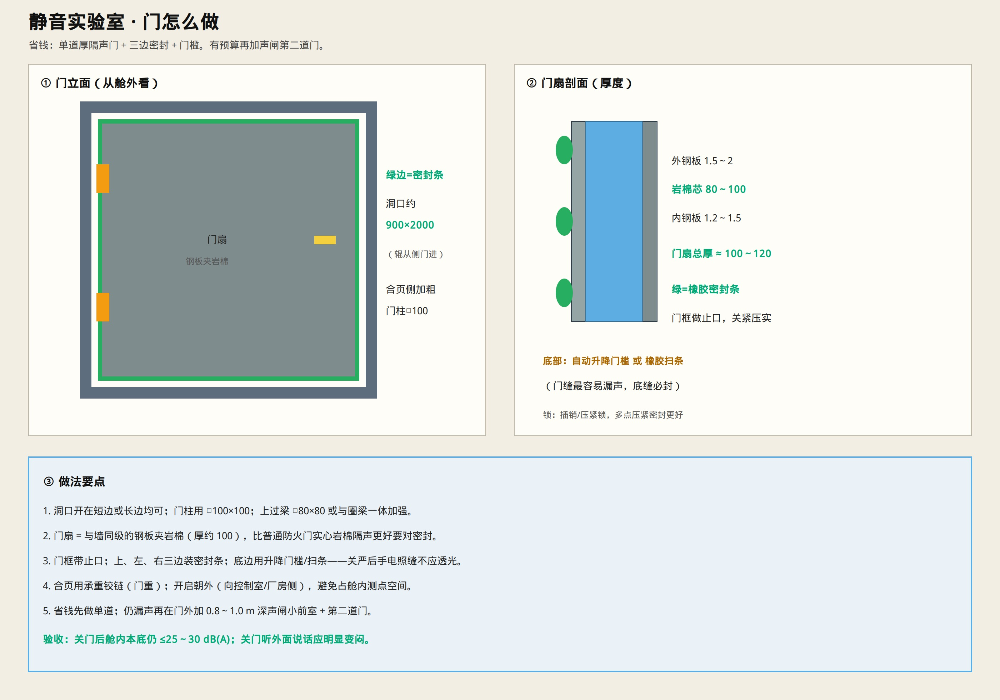

# 静音实验室 · 门怎么做

> 省钱版：**单道厚隔声门**；不够再加声闸第二道。  
> 只保留示意图与说明。



---

## 一句话

门扇做成和墙一样的 **钢板夹岩棉（约 100 厚）**，门框带止口，**三边密封条 + 底门槛**，关严不透光。

---

## 洞口与骨架

| 项 | 建议 |
|----|------|
| 洞口 | 约 **900×2000**（进人不进整辊也可；长辊可拆端盖侧抬） |
| 门柱 | **□100×100×3～4** |
| 上过梁 | **□80×80×3**（或与圈梁加强） |
| 开向 | **朝舱外开**，少占测点空间 |

---

## 门扇构造

```text
外钢板 1.5～2 mm
  → 岩棉 80～100 mm（容重 ≥80～100）
  → 内钢板 1.2～1.5 mm
门扇总厚 ≈ 100～120 mm
```

也可买成品 **隔声门**（标称 Rw≥35～40 dB），尺寸按洞口定做。

---

## 密封（比门扇材料更关键）

| 位置 | 做法 |
|------|------|
| 上、左、右 | 门框止口 + **橡胶密封条**，关门压实 |
| 底边 | **自动升降门槛** 或厚橡胶扫条（最易漏声） |
| 锁 | 插销/压紧锁；能多点压紧更好 |
| 合页 | 承重铰链（门重） |

**验收：** 关门用手电照缝 **不应透光**；舱内本底仍要到 **≤25～30 dB(A)**。

---

## 还漏声怎么办

在门外加 **声闸前室**（深约 0.8～1.0 m）再装第二道门——两道门不要同时大开。

常规省钱实验：**先做好单道密封**，多数够用。

实验室总工艺：[`SILENT_LAB_BUILD.md`](./SILENT_LAB_BUILD.md)

达标要求：**必须做成双道声闸**（见 [`SILENT_LAB_STANDARD.md`](./SILENT_LAB_STANDARD.md)），单道门只作省钱过渡。
