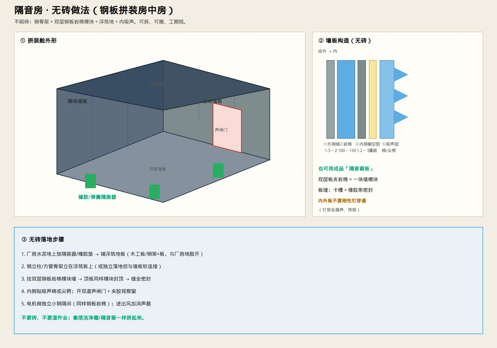
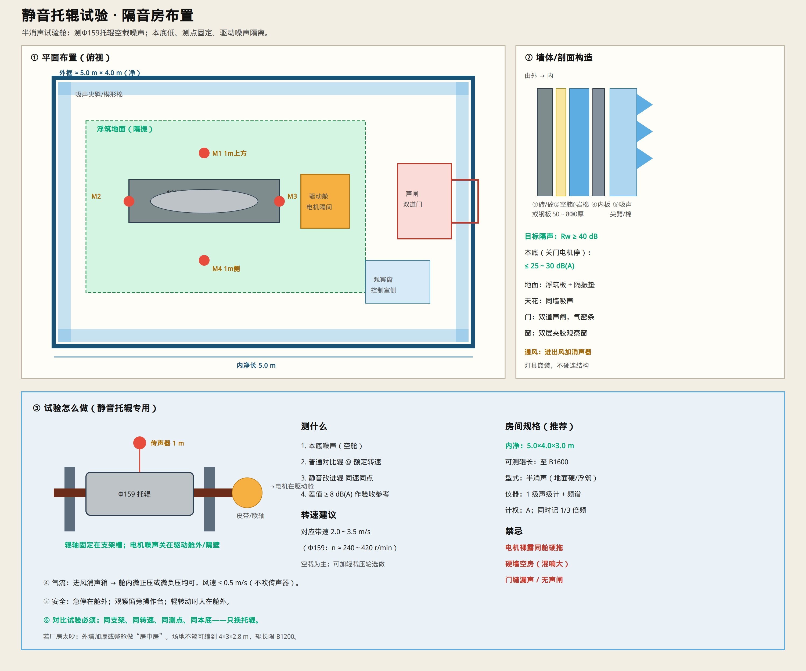
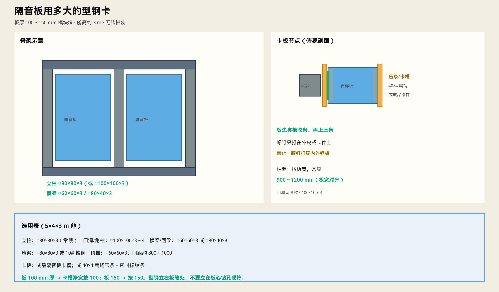
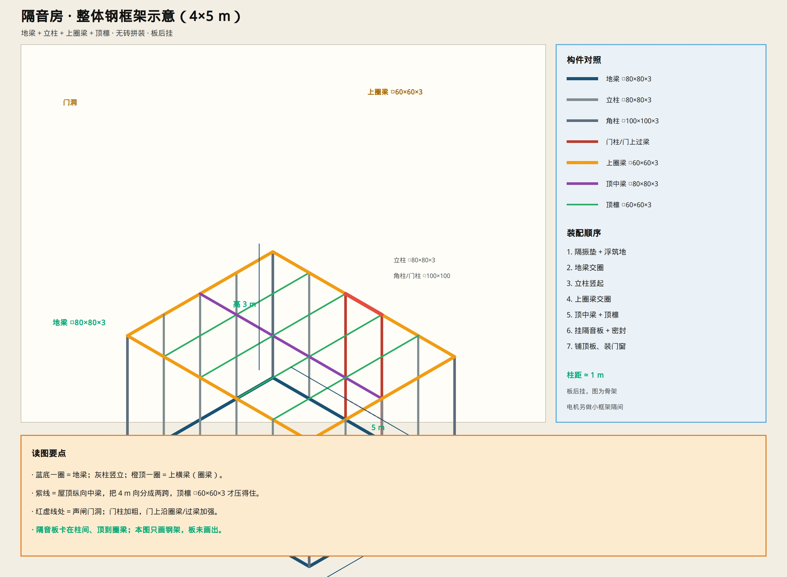
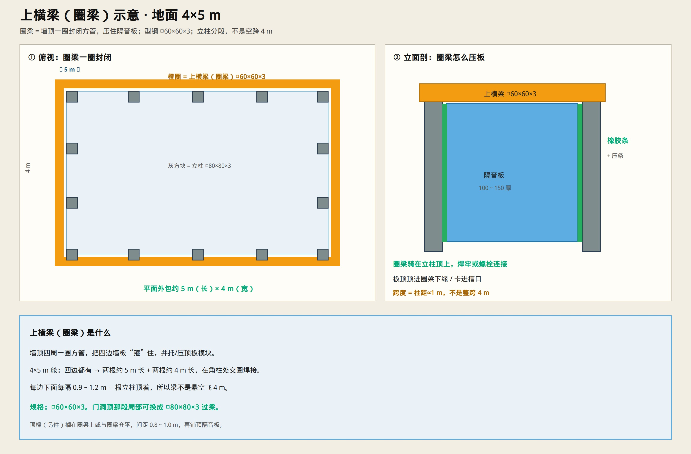
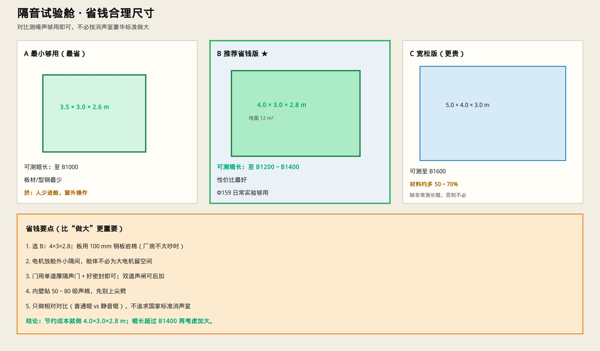

# 静音托辊实验 · 隔音房设计

> 用途：对比测 Φ159 静音托辊空载噪声（相对普通辊）。  
> 只保留示意图与说明。





---

## 一句话

做一个 **半消声试验舱**：**不要砖**，用钢板岩棉模块拼房中房；墙顶吸声、地面浮筑、电机关驱动舱；测点 1 m；本底约 **25～30 dB(A)**。

---

## 无砖怎么做（推荐）

```text
厂房地面
  → 隔振器/橡胶垫
  → 浮筑地板（与厂房脱开）
  → 钢骨架 + 双层钢板夹岩棉模块墙/顶
  → 板缝卡槽 + 橡胶条密封
  → 内侧吸声棉或尖劈
  → 双道声闸门 + 夹胶观察窗
  → 电机另做小钢隔间；风口加消声器
```

| 层 | 做法 | 厚度约 |
|----|------|--------|
| ① 外钢板 | 镀锌/彩钢 | 1.5～2 mm |
| ② 岩棉 | 容重 ≥ 80～100 kg/m³ | 100～150 mm |
| ③ 内钢板 | 镀锌板 | 1.2～1.5 mm |
| ④ 空腔/隔振 | 内外壳软连接，**禁止钉穿通** | 视模块 |
| ⑤ 吸声 | 离心棉 / 尖劈贴内壁 | 50～100 mm（尖劈更长） |

也可直接买成品 **隔音箱板/声学模块** 拼装，原理一样。



### 用多大的型钢卡板（5×4×3 m 舱）

| 部位 | 推荐型钢 | 说明 |
|------|----------|------|
| **立柱** | **□80×80×3** | 常规柱；柱距按板宽 **900～1200 mm** |
| **角柱 / 门洞柱** | **□100×100×3～4** | 开门处加粗 |
| **上横梁 / 圈梁** | **□60×60×3** | 墙顶一圈封闭；立柱分段（4×5 m 见下图） |
| **地梁** | **□80×80×3** 或 **10# 槽钢** | 落在浮筑板/隔振垫上 |
| **顶檩** | **□60×60×3** | 间距约 800～1000 mm |
| **卡板压条** | **40×4 扁钢** 或成品卡槽 | 板边夹 **橡胶条** 再压紧 |





**圈梁**：墙顶四周一圈 □60×60×3，角部交圈；下面每隔 0.9～1.2 m 立柱顶着。门洞顶局部可用 □80×80×3。

- 板厚 **100** → 卡槽按 100；板厚 **150** → 卡槽按 150  
- 螺钉只打外皮/卡件，**禁止一颗钉打穿内外钢板**  
- 有成品隔音板配套龙骨时，优先用厂家卡槽，尺寸按上表同级选取  

---

## 房间规格（节约成本 · 推荐）



| 档 | 内净尺寸 | 可测辊长 | 什么时候选 |
|----|----------|----------|------------|
| **B 推荐省钱** | **4.0 × 3.0 × 2.8 m** | B1200～B1400 | **日常 Φ159 实验，优先这个** |
| A 最小 | 3.5 × 3.0 × 2.6 m | 至 B1000 | 预算很紧、人少进舱 |
| C 宽松 | 5.0 × 4.0 × 3.0 m | 至 B1600 | 常测长辊才值得 |

**节约结论：做成 4.0×3.0×2.8 m 最合理。** 再大材料大约多一半，对比测噪声收益不大。

省钱做法配套：
- 墙板 **100 mm** 钢板岩棉（厂房很吵再上 150）  
- 电机舱外小隔间；门先做 **单道厚隔声门**（密封做好）  
- 内壁贴 **50～80 mm** 吸声棉，尖劈可后加  
- 只做相对对比，不按标准消声室做大  

| 项 | 建议 |
|----|------|
| 型式 | 半消声（墙顶吸声；地面浮筑） |
| 隔声 | 模块墙 **Rw ≥ 40 dB** |
| 本底 | 关门、电机停：**≤ 25～30 dB(A)** |

- **地面**：浮筑板 + 隔振垫  
- **门**：厚隔声门 + 气密条（有预算再上双道声闸）  
- **窗**：双层夹胶观察窗  
- **通风**：进出风加消声器；舱内风速 &lt; 0.5 m/s  

---

## 试验布置

| 区 | 干什么 |
|----|--------|
| 托辊台架 | 轴入支架槽，Φ159 空转 |
| **驱动舱** | 电机/减速机关在隔壁或舱内小隔间，皮带/软轴传动 |
| 测点 M1～M4 | 辊中心上方/侧方 **1 m**（与验收口径一致） |
| 控制室 | 舱外看窗、记数、急停 |

转速：对应带速 2.0～3.5 m/s → Φ159 约 **240～420 r/min**。

---

## 测什么（对比法）

1. 本底（空舱）  
2. 普通对比辊 @ 额定转速  
3. 静音改进辊 **同速同点同支架**  
4. 差值作参考：较普通辊低 **≥ 8 dB(A)**（与设计验收口径一致）  

同时记 A 计权总级 + 1/3 倍频程（看轴承高频有没有压下来）。

---

## 禁忌

- 电机与托辊裸露同舱硬拖（电机噪声盖过辊）  
- 硬墙空房（混响大，测不准）  
- 单薄门缝漏声、无声闸  
- 换辊时改测点/改转速（对比作废）  

---

## 最小落地版（预算紧）

若暂不能做完整尖劈房：

1. 厂房屋角砌/拼 **房中房** 钢板岩棉舱 4×3×2.8  
2. 内贴 50～100 厚吸声棉  
3. 电机务必外置隔间  
4. 仍用 1 m 固定测点做 **相对对比**（绝对值误差大，差值仍有用）  

完整多视图见上图。验收指标对接：[`DESIGN.md`](./DESIGN.md) §7。

测试工具与测序：[`TEST_TOOLS_ENV.md`](./TEST_TOOLS_ENV.md)
