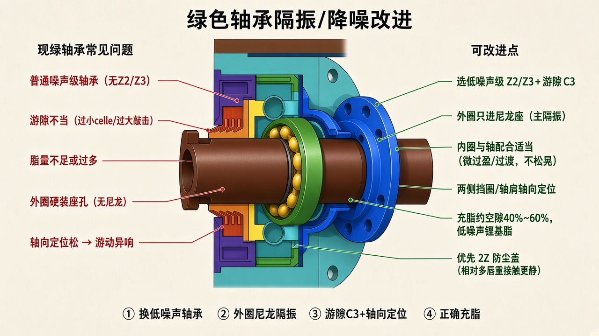

# 绿色轴承还能改进吗？

> 依据你 CAD 里的绿色隔振/消音安装（见总原理）。  
> 总原理：[`SILENT_SEAT_PRINCIPLE.md`](./SILENT_SEAT_PRINCIPLE.md)。  
> **隔音套改法：** [`GREEN_MUFFLER_IMPROVE.md`](./GREEN_MUFFLER_IMPROVE.md)。  
> 只保留示意图与说明。  
> **红色密封能否隔音：** [`RED_SEAL_SOUND.md`](./RED_SEAL_SOUND.md)



---

## 结论

**可以。** 绿色轴承既是回转件，也是主要振源；改进分两块：

1. **隔振**：外圈不要硬装端座 → 进尼龙降噪座（前面说的主静音）  
2. **降振源**：把轴承自身选对、装对、脂加对，少产生噪声  

实心轴仍然只承力，不靠轴做阻尼。

---

## 现常见问题

| 问题 | 后果 |
|------|------|
| 普通噪声级（无 Z2/Z3） | 滚道声偏大 |
| 游隙过小 / 过大 | 发热啸叫 / 滚道敲击 |
| 外圈硬装青绿座 | 振动直通管体 |
| 轴向没定位牢 | 游动、周期性异响 |
| 脂过少或过多 | 干摩擦或搅脂噪声 |

---

## 可改进点（对着绿件）

| 改什么 | 怎么改 | 作用 |
|--------|--------|------|
| 轴承规格 | 低噪声级 **Z2/Z3**，游隙 **C3** | 从源头减小滚道噪声 |
| 外圈安装 | 只进 **尼龙座**，不碰钢/硬座 | **主隔振** → 管体少鼓 |
| 内圈安装 | 与轴过渡/微过盈，不松晃 | 少内圈敲击 |
| 轴向 | 轴肩 + 挡圈定位 | 防游动异响 |
| 润滑 | 空隙约 **40%～60%**，低噪声锂基脂 | 滚道平稳、少干摩擦 |
| 密封形式 | 托辊常用 **2Z**（防尘盖） | 比多道重接触唇更不易啸叫 |

迷宫、软唇仍在轴承外侧做防尘，**不代替**尼龙座隔振。

```text
振源：绿轴承滚道
  ↓
隔振：外圈 → 尼龙座 → 端座 → 管（振动削弱）
  ↓
降源：Z2/Z3 + C3 + 正确脂 + 轴向定位
```

---

## 一句话

绿轴承能改进：**外面用尼龙隔振，自身换低噪声级并装正加好脂**；两件事一起做，比只换轴承或只加座更静。
