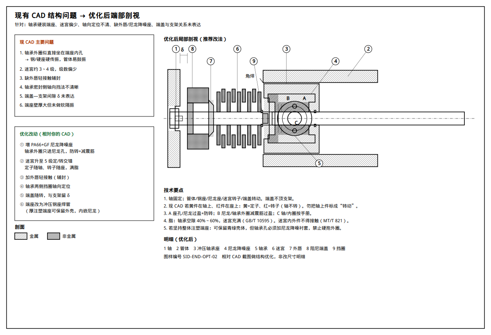

# 现有 CAD 端部结构优化说明

> 针对仓库内 CAD 截图 [`figures/ref-cad-current.jpg`](./figures/ref-cad-current.jpg) 的优化改法。  
> 优化图：[`figures/08-cad-optimized.png`](./figures/08-cad-optimized.png)  
> 完整推荐构型仍见 [`INTEGRATED_DESIGN.md`](./INTEGRATED_DESIGN.md)。

---

## 1. 现 CAD 读图（按截图）

从左（辊外）到右（辊内）大致为：

| 颜色/形态 | 推断零件 | 问题 |
|-----------|----------|------|
| 灰轴 | 轴 | OK；须确认固定不转、端头入支架槽 |
| 紫件 | 端盖/外罩 | 缺与支架间隙 δ 的表达 |
| 红/黄齿 | 迷宫 | 级数约 3～4，偏少；动静标注易混 |
| 绿色轴承 | 深沟球轴承 | **外圈似直接坐在青绿端座孔内** |
| 青绿厚端座 | 轴承座/端壳体 | 壁厚大但**无软隔振**；硬传振到管体 |
| 棕色散料管 | 管体 | OK |

---

## 2. 优化原则（不动总体外形也能改）

1. **静音**：轴承外圈与钢/硬座之间加 **PA66+GF 尼龙降噪座**（防转 + 减震筋）。  
2. **密封**：迷宫升到 **≥5 级**定/转交错 + 满脂；外侧加 **外唇轻接触**。  
3. **运动学**：轴固定；轴上迷宫＝定子；座/端盖侧＝转子；端盖随转、**不顶支架**。  
4. **定位**：轴承两侧（或一侧轴肩 + 一侧挡圈）轴向定位写清。  
5. **承力**：管体与承力座仍用钢座焊接（或注塑壳内嵌钢环）；尼龙只隔振传载，须校核。

---

## 3. 相对 CAD 的具体改动清单

| 序号 | 改动 | 做法 | 目的 |
|------|------|------|------|
| 1 | 加尼龙降噪座 | 轴承外圈只进尼龙孔；尼龙外圆过盈进端座，带防转凸筋 | 切断硬传振 |
| 2 | 迷宫升级 | 5 级以上交错齿，间隙 0.3～0.6 mm，满脂 | 提高防尘、保持低摩擦 |
| 3 | 加外唇 | 端盖内侧轻接触唇（NBR） | 挡粗颗粒 |
| 4 | 轴向定位 | 轴承两侧挡圈/轴肩明确 | 防游动噪声 |
| 5 | 端盖—支架 | 留 δ，端盖孔径 > 轴径 | 防扫膛 |
| 6 | 端座 | 优先冲压钢座焊管；若保留注塑厚端座，**内孔必须加尼龙衬套** | 强度 + 静音 |

### 关于你图里红/黄迷宫

若 **黄件在轴上、红件在座上**：

- 黄＝**定子（不转）**  
- 红＝**转子（随辊转）**  

轴是固定的，不要把轴上黄件标成“转动件”。

---

## 4. 两种落地路径（按你现有模型选）

### 路径 A（推荐，改动清晰）

弃“厚注塑端座硬抱轴承”，改为：

`管体 —焊— 冲压钢座 —过盈+防转— 尼龙降噪座 —轴承— 轴`  
外侧：`挡圈 + 5 级迷宫 + 外唇 + 阻尼端盖`

### 路径 B（少改外形）

保留青绿厚端座外形与管体配合，仅：

1. 端座轴承孔加大，压入 **尼龙降噪衬套**；  
2. 加长密封腔，迷宫改为 5 级并加外唇；  
3. 紫端盖与支架校核 δ；  
4. 补轴承挡圈槽。

路径 B 适合模具已开、只想改内部；路径 A 更贴近 DTⅡ 成熟钢座体系。

---

## 5. 装配顺序（优化后一端）

1. 钢座（或带钢嵌件的端座）与管体固连并校圆  
2. 压入尼龙降噪座（凸筋对槽）  
3. 轴承涂脂压入尼龙孔  
4. 装迷宫定子（轴）/转子（座）、外唇、挡圈  
5. 穿轴、对称定位  
6. 扣阻尼端盖，保证轴伸与 δ  
7. 动平衡；阻力/噪声/密封抽检  

---

## 6. 验收对照

| 项 | 要求 |
|----|------|
| 轴承外圈 | 不与钢座直接接触 |
| 迷宫 | 定转子不接触；满脂 |
| δ | 上架无碰擦 |
| 噪声 | 相对原 CAD 硬装结构做同台对比 |
| 标准 | GB/T 10595 充脂；MT/T 821 迷宫不接触 |

---

## 7. 图样

