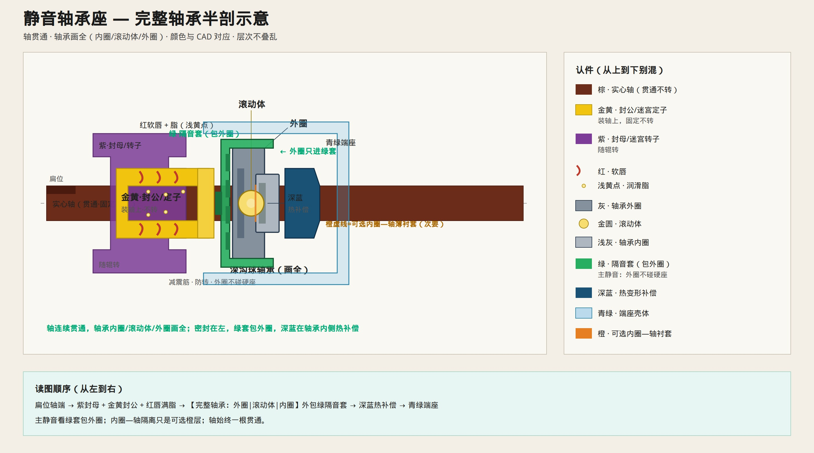

# 静音轴承座 — 完整轴承示意

> 把轴承画全（内圈 / 滚动体 / 外圈），轴贯通，颜色一次认清。  
> 只保留示意图与说明。

---

## 读图顺序（左 → 右）

1. **棕轴**贯通、固定  
2. **紫封母**（转）+ **金黄封公**（不转）+ **红软唇** + **脂**  
3. **完整轴承**：外圈 | 滚动体 | 内圈  
4. **绿隔音套**只包**外圈**（主静音）  
5. **深蓝**热补偿  
6. **青绿**端座  

可选：内圈与轴之间薄橙衬套（次要，见 [`INNER_RACE_SHAFT.md`](./INNER_RACE_SHAFT.md)）。

颜色对照：[`COLOR_LEGEND.md`](./COLOR_LEGEND.md)
