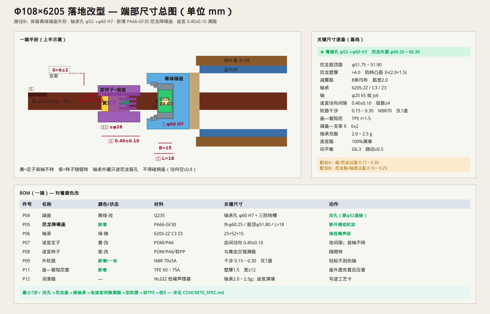

# 竞品静音托辊 — 可落地改型规格书（基线 Φ108×6205）

> **用途**：对着你 SolidWorks 装配体（棕外套+蓝内衬+青绿端座+绿轴承+黄/紫迷宫）直接改模、开料、装配、验收。  
> **基线规格已锁死**：辊径 **Φ108**、轴承 **6205**、轴 **φ25**。其它规格用文末换算表。  
> **总图**：[`figures/16-concrete-landable.png`](./figures/16-concrete-landable.png)  
> 概念对比仍见 [`IMPROVE_COMPETITOR.md`](./IMPROVE_COMPETITOR.md)。



---

## 0. 一页纸：你现在要改什么

| 优先级 | 改什么（对着颜色） | 具体动作 | 验收数 |
|--------|--------------------|----------|--------|
| ★必做 | 青绿端座轴承孔 | φ52 → **φ60 H7**，压入尼龙降噪座 | 轴承外圈**不得**碰青绿座 |
| ★必做 | 新增尼龙降噪座 | PA66-GF30，内孔抱 6205 外圈 | 过盈见 §3 |
| ★必做 | 绿轴承 | 换成 **6205-2Z/C3/Z3**（或 Z2） | 噪声级写在 BOM |
| ★必做 | 黄定子 + 紫转子 | 齿间径向间隙 **0.40±0.10**，满脂 | 手转无刮蹭 |
| 建议 | 最外加 1 道软唇 | NBR70，径向干涉 **0.15～0.30** | 不伤轴 |
| 建议 | 青绿座 ↔ 蓝内衬 | 加 **1.5 mm** TPE 阻尼套 | 压装到位 |
| 建议 | 紫件外端面 | 相对支架内侧 **δ = 6±2** | 上架不碰 |

---

## 1. 锁定基线（先按这一支做通）

| 项目 | 锁定值 | 说明 |
|------|--------|------|
| 辊外径 D | **108 mm** | 对标竞品双层管常用档 |
| 轴承 | **6205**（d25×D52×B15） | 竞品绿件按此改；若实测是 6204 见 §8 |
| 轴径 d | **25 mm** | 45# 冷拉；两端扁位入支架槽 |
| 轴承噪声/游隙 | **Z3（可 Z2）+ C3** | 禁止无噪声分组的杂牌 |
| 路径 | **路径 B：保留青绿端座外形** | 只改内孔 + 加尼龙座，少动模具外形 |

若你 CAD 实测轴承是 6204（D=47），把全文「52→60」换成「47→55」，尼龙壁厚仍取约 **4 mm**。

---

## 2. BOM（一端；两端对称 ×2）

| 件号 | 名称 | 对应竞品颜色 | 材料/牌号 | 关键尺寸 (mm) | 数量/端 | 备注 |
|------|------|--------------|-----------|--------------|---------|------|
| P01 | 轴 | 深红 | 45# 冷拉圆钢 | φ25 h6；扁位宽 20±0.2，深 ≥8 | 0.5（整辊 1） | 两端扁位；表面 Ra1.6 |
| P02 | 外套管 | 棕 | Q235 ERW 精密管 | Φ108×壁厚 3.5～4.5 | 0.5 | 焊后校圆 |
| P03 | 内衬管 | 蓝 | Q235 / 同系 | 外径配外套；壁厚 2.5～3.5 | 0.5 | 与外套过盈或胶层 |
| P04 | 端座 | 青绿 | 冷冲压 Q235 或机加碳钢 | 轴承孔改为 **φ60 H7** | 1 | **原 φ52 孔废除** |
| **P05** | **尼龙降噪座** | **新增（灰蓝）** | **PA66-GF30**（干燥后注塑） | 见 §4 零件图 | **1** | **主静音件** |
| P06 | 深沟球轴承 | 绿 | **6205-2Z C3 Z3** | 25×52×15 | 1 | 可 Z2；充脂见 P12 |
| P07 | 迷宫定子 | 黄 | POM-C 或 PA6（软质级可 TPE 包覆） | 内孔 φ25 H7/js6；齿见 §5 | 1 | **装轴上，不转** |
| P08 | 迷宫转子 | 紫 | POM / PA6 / 软质 PP | 外圆配端座/端盖；齿见 §5 | 1 | **随辊转** |
| P09 | 外软唇 | 可与紫一体或另件 | **NBR 70±5 Shore A** | 唇尖干涉 0.15～0.30 | 1 | **仅 1 道**；轻贴 |
| P10 | 阻尼端盖 | 可并入紫件 | HDPE / PA6 | 中心孔 **≥ φ28**（φ25+3） | 1 | 不抱轴 |
| P11 | 座—管阻尼套 | 新增 | TPE 60～75A 或厌氧阻尼胶 | 壁厚 **1.5**；宽 ≥12 | 1 | 套在青绿座外圆 |
| P12 | 润滑脂 | — | 低噪声锂基脂 NLGI 2（≥GB/T 7324） | 轴承腔 **≈2.0～2.5 g**；迷宫 **满填** | — | 轴承空隙 40～60% |
| P13 | 轴用挡圈 | — | 65Mn，φ25 用 | GB/T 894.1 | 1～2 | 轴向定位轴承/定子 |
| P14 | 轴承内侧挡脂环 | 竞品深蓝小件可保留 | PA6 / 薄钢板 | 按现件 | 1 | 防脂内窜即可 |

**采购一句话（可贴采购单）**

> 6205-2Z/C3/Z3 ×2；PA66-GF30 尼龙降噪座（按附图）×2；NBR70 外唇×2；NLGI2 低噪声锂基脂；其余沿用现双层管+青绿端座改孔。

---

## 3. 配合与公差表（可直接上图）

| 代号 | 界面 | 名义尺寸 | 孔公差 | 轴/外圆公差 | 过盈/间隙（装配态） | 工艺 |
|------|------|----------|--------|-------------|---------------------|------|
| **A** | 青绿座孔 / 尼龙座外圆 | **φ60** | 座孔 **H7**（+0.030/0） | 尼龙外圆 **φ60.20～60.30**（注塑后精车或模具控） | 过盈 **0.17～0.30** | 室温压入；凸筋对槽 |
| **B** | 尼龙内孔筋 / 轴承外圈 | **φ52** | 筋顶圆 **φ51.75～51.90** | 轴承外圈 φ52（0/−0.013） | 筋顶过盈 **0.10～0.25** | 压入力见 §6；**外圈不得碰钢** |
| **C** | 轴 / 轴承内圈 | **φ25** | 轴承内孔（0/−0.010） | 轴 **φ25 k5**（+0.002/+0.011）或 **js6** | 过渡～微过盈 | 冷压或温差装配 |
| **D** | 轴 / 黄定子内孔 | **φ25** | 定子 **H7** 或轻过盈孔 | 轴 φ25 | 过盈 0～0.05 或挡圈定位 | 禁止定子随轴打滑 |
| **E** | 迷宫齿径向间隙 | — | — | — | **0.40±0.10**（任一对齿） | 装后塞尺/光学抽检 |
| **F** | 软唇 / 对偶面 | — | — | — | 径向干涉 **0.15～0.30** | 只 1 道；禁止多唇重压 |
| **G** | 端盖孔 / 轴 | φ25 | 端盖孔 **≥φ28** | — | 径向单边 ≥1.5 | **不承力** |
| **δ** | 端盖外端面 / 支架内侧 | — | — | — | **6±2**（设计名义） | 开档−辊长−轴伸反算；**严禁碰** |
| **H** | 青绿座外圆 / 阻尼套 / 蓝管内孔 | 按现管 | 管孔按现 | 套厚 **1.5** | 套压缩约 0.3～0.6 | 先套后压入管端 |

未注形位：青绿座轴承孔相对管轴同轴度 **φ0.05**；两端座同轴度整辊 **φ0.10**。

---

## 4. 尼龙降噪座零件尺寸（P05）— 照此开模/机加

```text
                    ┌──── 翻边外径 φ68 ±0.2 ────┐
                    │ 翻边厚 2.0±0.2              │
    ────┬───────────┴────────────────────────────┴──
        │  外圆 φ60.25±0.05（压入青绿座 φ60 H7）
        │  轴向长 L = 18.0（≥ 轴承宽 15 + 内侧挡 2）
        │
        │  内孔：基准孔 φ52.4（非配合）
        │  ★减震筋：均布 8 条，筋顶圆 φ51.80±0.05
        │     筋宽 2.0，筋高 ≈0.3（相对基准孔）
        │
        │  ★防转：外圆均布 3 条凸筋 2.0×1.5（高×宽）
        │     青绿座孔内对应 3 条轴向槽 2.2×1.7
    ────┴────────────────────────────────────────
材料：PA66-GF30；注塑后含水率按供应商规范干燥；
禁止轴承外圈任何一点碰到青绿座台阶——座孔台阶处径向单边空 ≥0.8。
```

| 参数 | 值 | 为什么 |
|------|-----|--------|
| 径向壁厚（筋底到外圆） | ≈ **4.0 mm** | 隔振够、蠕变可控 |
| 筋数量 | **8** | 抱合均匀，少啸叫 |
| 防转筋 | **3×120°** | 双保险，防打滑发热 |
| 翻边 | φ68×2 | 轴向挡、方便压装到位 |

**校核提示（中载 Φ108）**：单辊径向载荷按 DTⅡ 表取；尼龙座挤压应力用筋顶接触估算，常温安全系数 ≥2；环境长期 >80℃ 改 PPS-GF 或加厚壁。

---

## 5. 迷宫 + 软唇几何（P07/P08/P09）

### 5.1 齿形（推荐改到此数，保留软质不刮轴）

| 参数 | 值 |
|------|-----|
| 交错级数 | **≥4**（推荐 5；竞品现有 4 可先收间隙再加 1 级） |
| 齿高 | **2.5～3.0** |
| 齿厚 | **1.5～2.0** |
| 齿槽宽 | **2.0～2.5**（保证交错后径向缝 0.4） |
| **径向间隙（每对齿）** | **0.40±0.10** |
| 轴向间隙（齿侧面） | **0.30～0.60** |
| 脂 | 齿槽/空隙 **100% 充满**，无空洞 |

黄＝定子（轴上固定）；紫＝转子（随青绿座/端盖转）。**装反即废**。

### 5.2 外软唇（仅 1 道）

| 参数 | 值 |
|------|-----|
| 材料 | NBR 70±5A，可与紫件包胶一体 |
| 唇尖截面 | 三角形或圆弧，唇高 1.5～2.0 |
| 对偶面 | 黄定子外圆或轴肩光滑面 Ra1.6 |
| 径向干涉 | **0.15～0.30**（装配后） |
| 轴向位置 | 迷宫最外侧一道 |

---

## 6. SolidWorks 改模步骤（对着你现装配体）

按特征树颜色件操作；每步改完 Rebuild + 干涉检查。

### 步骤 1 — 青绿端座（改孔）

1. 打开青绿端座零件。  
2. 原轴承孔若为 **φ52**：改为 **φ60 H7**（草图尺寸改 60，公差孔配合 H7）。  
3. 孔底台阶：保证尼龙座翻边可落座；台阶内径 ≥φ53，使 **φ52 轴承外圈悬空不碰钢**（径向空 ≥0.8）。  
4. 在孔壁加 **3 条轴向防转槽**（宽 2.2、深 1.7、均布 120°），长贯通配合面。  
5. 外圆与蓝管内孔配合面预留 **+1.5 mm** 阻尼套厚度（外圆车小 3 mm 直径，或管孔加大；二选一，见步骤 5）。

### 步骤 2 — 新建「尼龙降噪座」零件

1. 新建零件，按 §4 尺寸建模。  
2. 材料：自定义 `PA66-GF30`，密度 ≈1.35 g/cm³。  
3. 插入装配体：同心于青绿座孔，翻边贴齐外侧台阶。  
4. 配合：同轴 + 重合翻边；检查与轴承外圈只有筋接触。

### 步骤 3 — 绿轴承

1. 替换为 Toolbox 或供应商模型 **6205-2Z**。  
2. 配置属性备注：`C3, Z3`。  
3. 外圈只与尼龙筋配合；内圈与轴 φ25 k5/js6。  
4. 两侧加挡圈槽位置（轴上）按轴承宽 15 对中。

### 步骤 4 — 黄/紫迷宫

1. 测量现齿间最小径向距；改齿顶/齿根使装配后 **0.40±0.10**。  
2. 黄件：固定到轴（同轴+轴向挡圈/轴肩）。  
3. 紫件：固定到青绿座或端盖（随转）。  
4. 在齿槽加「脂」外观零件可选；图纸注：**空隙充满润滑脂**。  
5. 最外侧加 P09 软唇（可扫掠特征或单独零件布尔）。

### 步骤 5 — 座—管阻尼

- **法 A**：青绿座外圆直径减小 **3.0**（半径 1.5），套 1.5 厚 TPE 后再压入蓝管原孔。  
- **法 B**：蓝管内孔加大 **3.0**，座外圆不变 + TPE 套。  
优先法 A（少改管）。

### 步骤 6 — δ 与端盖孔

1. 端盖/紫件外端面到支架立板：装配里放支架参考面，标注 **δ=6**。  
2. 端盖中心孔改为 **≥φ28**。  
3. 轴伸长度保持能入支架槽（扁位外露按现支架槽深）。

### 步骤 7 — 出图

出 3 张图即可开工：

1. 端部装配剖视图（本规格 §0 表 + 本图尺寸）  
2. 尼龙降噪座零件图（§4）  
3. 青绿端座改孔零件图（φ60 H7 + 三槽）

---

## 7. 装配工艺卡（一端）

| 工步 | 操作 | 参数 | 自检 |
|------|------|------|------|
| 10 | 管端校圆；青绿座涂阻尼套/胶 | 套厚 1.5 | 套无破 |
| 20 | 座压入蓝管内衬 | 压力记录；同轴 | 翻边贴齐管端 |
| 30 | 尼龙座压入青绿孔 | 凸筋对槽；压入到位翻边贴合 | 手抠不转 |
| 40 | 轴承涂脂压入尼龙孔 | 脂 **2.0～2.5 g**；压入力平稳无异响 | 外圈不碰钢座 |
| 50 | 轴上装黄定子 + 挡圈 | 定子不转 | 轴向无窜 |
| 60 | 齿槽抹脂至满 | 可见溢出一圈即可刮平 | 无空洞 |
| 70 | 紫转子+软唇装入座/端盖 | 唇干涉 0.15～0.30 | 唇无翻边撕裂 |
| 80 | 穿轴合装、装另一端 | 对称 | 手转灵活、无周期性刮擦声 |
| 90 | 扣端盖；查轴伸 | 端盖孔不擦轴 | — |
| 100 | 动平衡 | **G6.3**（高速可 G2.5） | 去重位置远离密封 |
| 110 | 台架 | 见 §9 | 合格入库 |

压装建议：尼龙座、轴承用铜套或尼龙垫块，**禁止锤击外圈歪压**。

---

## 8. 其它辊径换算（同一结构）

| 辊径 | 轴承 | 轴径 | 座孔（原→新） | 尼龙外圆 | 尼龙筋顶圆 | 轴承脂约 |
|------|------|------|---------------|----------|------------|----------|
| 89 | 6204 | 20 | 47→**55 H7** | 55.20～55.30 | 46.75～46.90 | 1.5～2.0 g |
| **108** | **6205** | **25** | **52→60 H7** | **60.20～60.30** | **51.75～51.90** | **2.0～2.5 g** |
| 133 | 6305 | 25 | 62→**70 H7** | 70.20～70.30 | 61.75～61.90 | 3.0～3.5 g |
| 133 | 6205 | 25 | 同 108 模块 | 同 108 | 同 108 | 同 108 |
| 159 | 6306 | 30 | 72→**80 H7** | 80.20～80.30 | 71.75～71.90 | 4.0～5.0 g |

原则：**尼龙径向壁厚保持 ≈4 mm**；迷宫间隙与软唇干涉**不随辊径放大**。

---

## 9. 验收标准（可写进检验规程）

| 项 | 方法 | 合格 |
|----|------|------|
| 轴承外圈—钢座 | 塞尺/目视装配剖 | **无接触**（≥0.8 空） |
| 迷宫接触 | 手转 + 听 | 无金属/塑料刮擦连续声 |
| 迷宫间隙 | 抽检剖切或工艺塞规 | 0.30～0.50 |
| 软唇 | 目视轴/对偶面 | 无切削状刮痕；仅轻微贴痕 |
| δ | 上架塞尺 | ≥4，且不碰（目标 6±2） |
| 旋转阻力 | 按 GB/T 10595 / MT/T 821 | **不高于**同规格竞品样件 |
| 噪声 | 同台空载，声级计 1 m | **低于**竞品（记录 dB(A) 与转速） |
| 淋水/粉尘 | MT/T 821 密封相关条款 | 阻力无明显恶化 |
| 平衡 | 动平衡机 | G6.3 |
| 径向跳动 | 百分表 | ≤0.5（精密 ≤0.3） |

---

## 10. 文件与图

| 内容 | 路径 |
|------|------|
| **本落地规格书** | `CONCRETE_SPEC.md` |
| 尺寸总图 | [`figures/16-concrete-landable.png`](./figures/16-concrete-landable.png) |
| 竞品对比概念 | [`IMPROVE_COMPETITOR.md`](./IMPROVE_COMPETITOR.md) |
| 竞品 CAD 截图 | [`figures/ref-competitor-end.jpg`](./figures/ref-competitor-end.jpg) |

---

## 11. 给你现场的最小动作清单（打印可贴墙）

1. 青绿座孔改 **φ60 H7** + 三防转槽  
2. 做/买 **PA66-GF30 尼龙座**（§4）压进去  
3. 轴承换成 **6205-2Z/C3/Z3**  
4. 黄紫齿间隙收到 **0.4 mm**，**抹满脂**  
5. 最外加 **1 道 NBR 软唇**（干涉 ≤0.3）  
6. 座外加 **1.5 mm TPE**；端盖孔 **≥φ28**；上架 **δ≈6**  
7. 按 §9 跟竞品同台测阻力和噪声  

做完这 7 步，就是可装机的静音改型件，不是概念方案。
