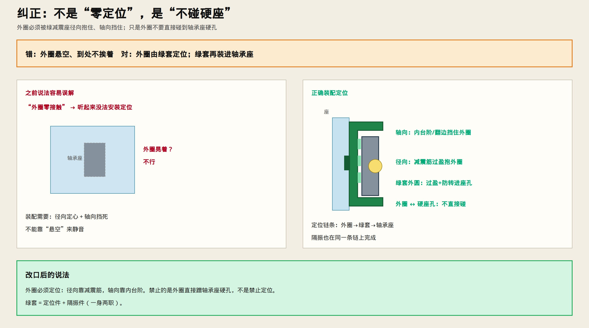
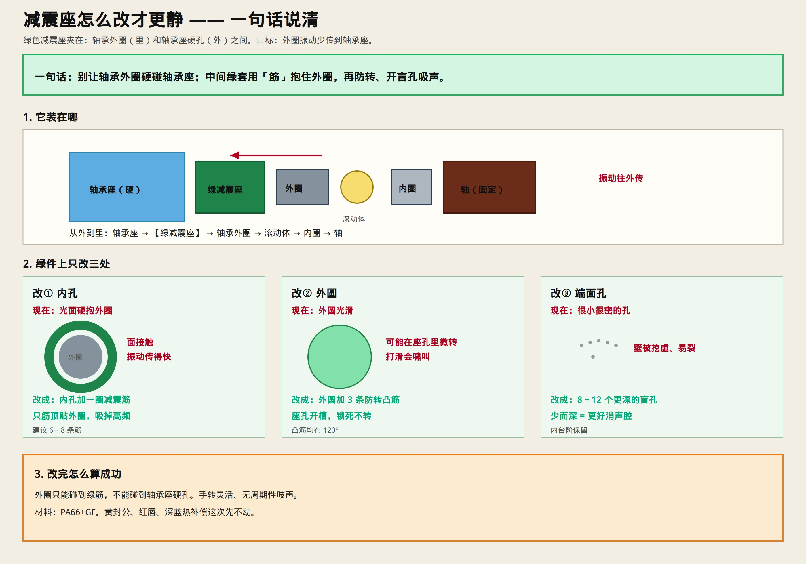

# 减震座怎么改才更静

> 只讲绿色减震座这一件。





---

## 先纠正一句

**“外圈零接触”说错了。**  
外圈必须安装定位，不能悬空。

正确说法：

- **要定位**：径向靠绿套减震筋抱住；轴向靠绿套内台阶/翻边挡住  
- **不要硬碰**：外圈不要直接蹭到轴承座硬孔  
- 绿套 = **定位件 + 隔振件**（一身两职）

```text
定位链：轴承外圈 → 绿减震座（筋+台阶） → 轴承座
隔振也在这条链上完成
```

---

## 一句话（改口后）

**外圈由绿套定位并隔振；绿套再装进轴承座。外圈不直接碰硬座孔。**

---

## 绿件上改三处

| 改 | 现在 | 改成 | 作用 |
|----|------|------|------|
| ① 内孔 | 光面 | **6～8 条减震筋**过盈抱外圈 | **径向定位** + 吸振 |
| ② 轴向 | （有台阶则保留） | **内台阶/翻边**挡外圈 | **轴向定位** |
| ③ 外圆 | 光滑 | **过盈 + 3 条防转凸筋**进座孔 | 绿套在座里定位、不打滑啸叫 |
| ④ 端面 | 过密小孔 | **8～12 个深盲孔** | 消声（次要） |

材料：PA66+GF。

---

## 改完怎么验收

- 外圈被绿筋抱紧、被台阶挡住 → **有定位、不晃**  
- 外圈与轴承座硬孔之间仍隔着绿套 → **不硬碰**  
- 手转灵活，无周期性啸叫  

黄封公、红唇+脂、深蓝热补偿这次先不动。
