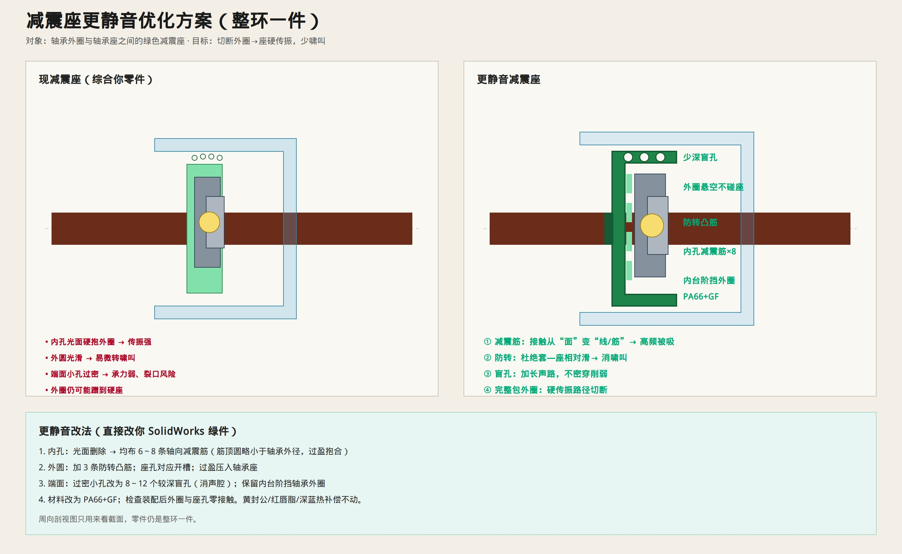

# 减震座更静音优化

> 对象：轴承**外圈**与**轴承座**之间的绿色减震座（整环一件）。  
> 你的周向剖视图只用来看截面，不是对开件。  
> 只保留示意图与说明。



原零件：[`ref-isolator-v2-plain.jpg`](./figures/ref-isolator-v2-plain.jpg) · [`ref-isolator-v1-holes.jpg`](./figures/ref-isolator-v1-holes.jpg) · [`ref-isolator-v3-half.jpg`](./figures/ref-isolator-v3-half.jpg)

---

## 为什么还能更静

现座主要靠材料本身；内孔光面硬抱外圈 → 振动仍容易传到轴承座和管体。  
要更静，必须让外圈**只通过弹性筋**接触减震座，并且**绝不碰到硬座**。

---

## 四条改法（直接改绿件）

| # | 改什么 | 更静音的原因 |
|---|--------|--------------|
| 1 | 内孔加 **6～8 条减震筋** 抱外圈 | 面接触→筋接触，高频被吸掉 |
| 2 | 外圆加 **3 条防转凸筋**（座孔开槽） | 杜绝套相对座微滑啸叫 |
| 3 | 端面过密小孔 → **8～12 个深盲孔** | 消声腔加长声路，又不把壁挖烂 |
| 4 | 保留内台阶；材料 **PA66+GF**；外圈与座孔零接触 | 切断硬传振主路径 |

```text
滚动体噪声 → 外圈 → 减震筋吸能 → 套体+盲孔耗声 → 轴承座（已弱）→ 管
```

---

## 不动的

黄封公、红软唇+满脂、深蓝热补偿、轴与内圈配合——这次只动绿色减震座。
