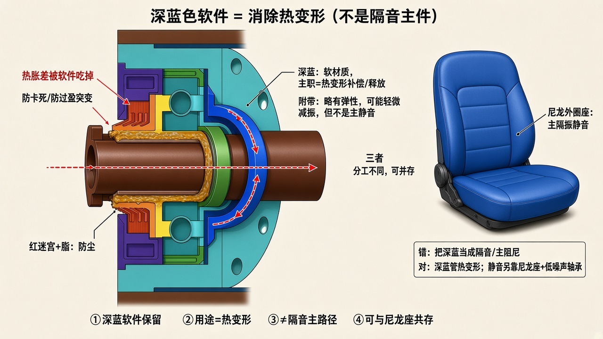

# 深蓝色软件是干什么的？

> 按你的说明纠正：深蓝件是**软材质**，用来**消除/吸收热变形**，不是隔音主件。  
> 总原理：[`SILENT_SEAT_PRINCIPLE.md`](./SILENT_SEAT_PRINCIPLE.md)。  
> 只保留示意图与说明。



---

## 结论

**深蓝件：软材质 → 主职是热变形补偿。**  
轴、座、轴承钢材热胀不一致时，软件把多余胀量“吃掉”，减轻卡死、过盈突变、额外应力。

它**不是**隔音箱，也**代替不了**轴承外圈尼龙降噪座的主静音作用。软材质可能带一点弹性减振，只是附带效果。

---

## 各件分工（别混）

| 零件 | 材质特点 | 主职 | 不是干什么 |
|------|----------|------|------------|
| **深蓝件** | **软** | **热变形补偿/释放** | 隔音、主隔振 |
| 红/橙迷宫 + 脂 | 软齿/满脂 | 防尘防水 | 隔音 |
| 亮蓝→尼龙外圈座（若改） | PA66+GF | **主静音隔振** | 热胀主补偿 |
| 绿轴承 | 钢 | 回转；选低噪声级 | — |
| 实心轴 | 钢 | 承力固定 | 不做阻尼 |

```text
热路径：温度升 → 轴/座胀量不同 → 深蓝软件变形吸收 → 不易卡
振路径：轴承振动 →（要静）尼龙外圈座 → 管体少鼓
尘路径：灰水 → 红迷宫+脂挡住
```

---

## 改进时怎么对待深蓝件

- **保留**其软材质、热补偿功能（人家这点是对的）  
- 不要指望靠它隔音  
- 若再加外圈尼龙降噪座：两者**可并存**——一个管热，一个管振  

说明：[`RED_SEAL_SOUND.md`](./RED_SEAL_SOUND.md)（红密封+脂）· [`EXISTING_SEAT_IMPROVE.md`](./EXISTING_SEAT_IMPROVE.md)（外圈隔振）
