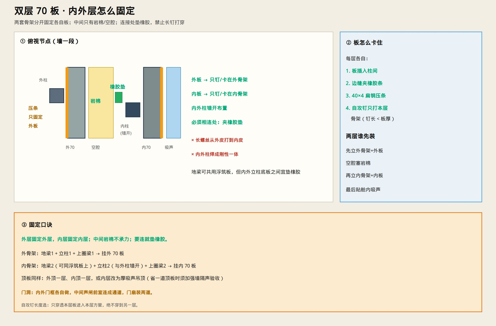

# 双层 70 板 · 内外层怎么固定

> 口诀：**外层固定外层，内层固定内层；中间岩棉不承力；要连就垫橡胶。**  
> 只保留示意图与说明。



---

## 怎么固定

### 两套骨架

| | 外层 | 内层 |
|--|------|------|
| 骨架 | 地梁1 + 立柱1 + 圈梁1 | 地梁2 + 立柱2 + 圈梁2 |
| 板 | 70 mm 挂在外骨架 | 70 mm 挂在内骨架 |
| 立柱 | 与内柱 **错开** | 与外柱错开 |
| 必须相连处 | — | 夹 **橡胶垫**，不钢对钢焊死 |

都落在浮筑地板上；内外立柱底板之间宜垫橡胶。

### 每层板的卡法（相同）

1. 板插入本层柱间  
2. 边缝夹橡胶条  
3. **40×4 扁钢压条**（或成品卡槽）  
4. 自攻钉 **只打进本层方管**（钉长 &lt; 板厚+方管壁，绝不穿到另一层）

### 安装顺序

```text
外骨架 → 外70板 → 空腔塞岩棉 → 内骨架 → 内70板 → 舱内吸声
```

---

## 禁止

- × 长螺丝从外皮打穿到内皮  
- × 内外柱焊成刚性一体  
- × 空腔整仓灌发泡胶（只允许缝隙堵胶）  

---

## 门洞

内外门框各自做，中间留声闸前室，装 **两道隔声门**。

墙板选型：[`figures/63-double-70mm-panels.jpg`](./figures/63-double-70mm-panels.jpg)  
建造总工艺：[`SILENT_LAB_BUILD.md`](./SILENT_LAB_BUILD.md)
