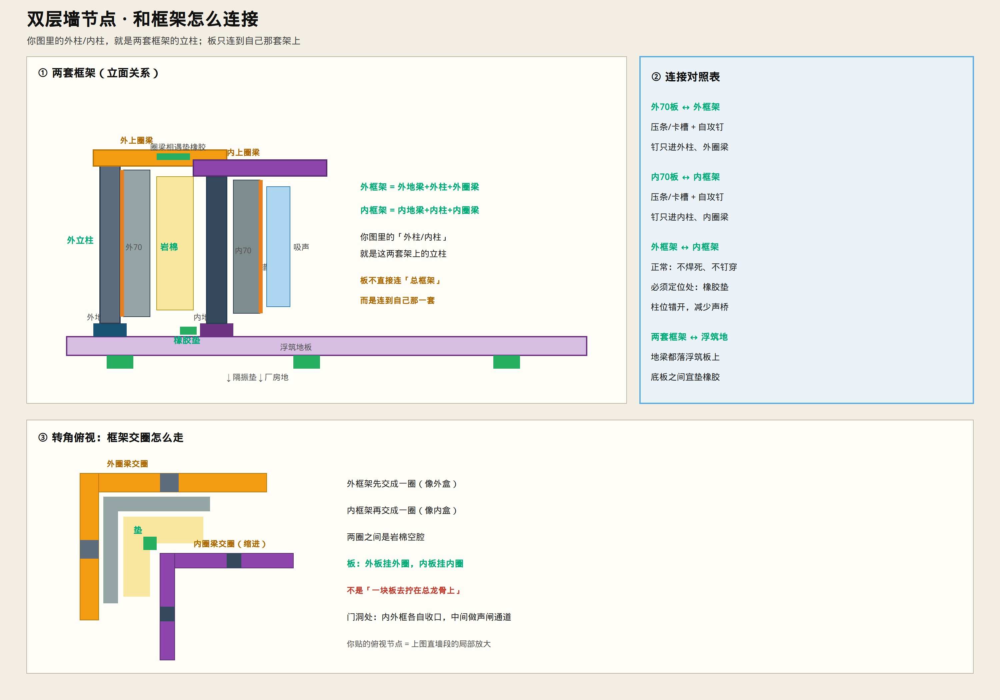
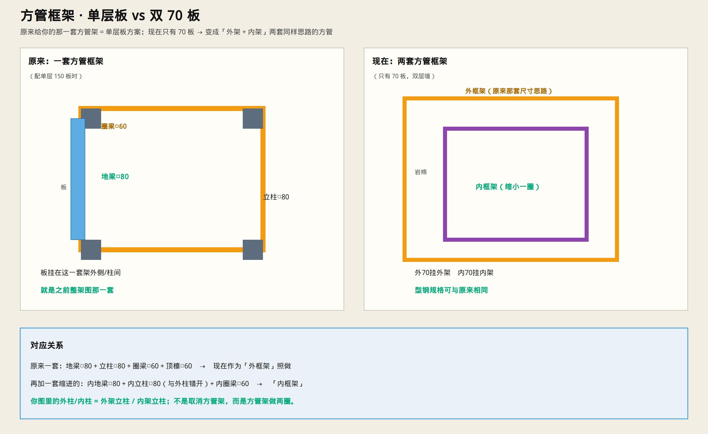

# 双层 70 板 · 内外层怎么固定

> 口诀：**外层固定外层，内层固定内层；中间岩棉不承力；要连就垫橡胶。**  
> 只保留示意图与说明。




---

## 和原来那套方管框架的关系



| | 原来（单层 150 板） | 现在（只有 70 板） |
|--|-------------------|-------------------|
| 框架 | **一套**方管：地梁□80 + 立柱□80 + 圈梁□60 | **两套**同样思路的方管 |
| 板 | 挂在这一套上 | 外 70 挂**外架**；内 70 挂**内架** |

所以：**不是取消方管架**，而是把原来那套当作外框架，再在里面缩进做一套内框架。

你图里的 **外柱 / 内柱**，就是：

| 图上名称 | 属于哪套框架 |
|----------|----------------|
| 外柱 | **外框架**立柱（= 原来那套立柱） |
| 内柱 | **内框架**立柱（新加一圈，与外柱错开） |

```text
外70板 ──压条/钉──→ 只连外框架
内70板 ──压条/钉──→ 只连内框架
外框架 ↔ 内框架 ──正常不焊死；定位处垫橡胶
两套框架 ──都落在──→ 浮筑地板上
```

不是「一块板拧到一根总龙骨上」，而是 **外盒框架 + 内盒框架**，板各挂各的。

---

## 怎么固定

### 两套骨架

| | 外层 | 内层 |
|--|------|------|
| 骨架 | 地梁1 + 立柱1 + 圈梁1 | 地梁2 + 立柱2 + 圈梁2 |
| 板 | 70 mm 挂在外骨架 | 70 mm 挂在内骨架 |
| 立柱 | 与内柱 **错开** | 与外柱错开 |
| 必须相连处 | — | 夹 **橡胶垫**，不钢对钢焊死 |

都落在浮筑地板上；内外立柱底板之间宜垫橡胶。

### 每层板的卡法（相同）

1. 板插入本层柱间  
2. 边缝夹橡胶条  
3. **40×4 扁钢压条**（或成品卡槽）  
4. 自攻钉 **只打进本层方管**（钉长 &lt; 板厚+方管壁，绝不穿到另一层）

### 安装顺序

```text
外骨架 → 外70板 → 空腔塞岩棉 → 内骨架 → 内70板 → 舱内吸声
```

---

## 禁止

- × 长螺丝从外皮打穿到内皮  
- × 内外柱焊成刚性一体  
- × 空腔整仓灌发泡胶（只允许缝隙堵胶）  

---

## 门洞

内外门框各自做，中间留声闸前室，装 **两道隔声门**。

墙板选型：[`figures/63-double-70mm-panels.jpg`](./figures/63-double-70mm-panels.jpg)  
建造总工艺：[`SILENT_LAB_BUILD.md`](./SILENT_LAB_BUILD.md)
