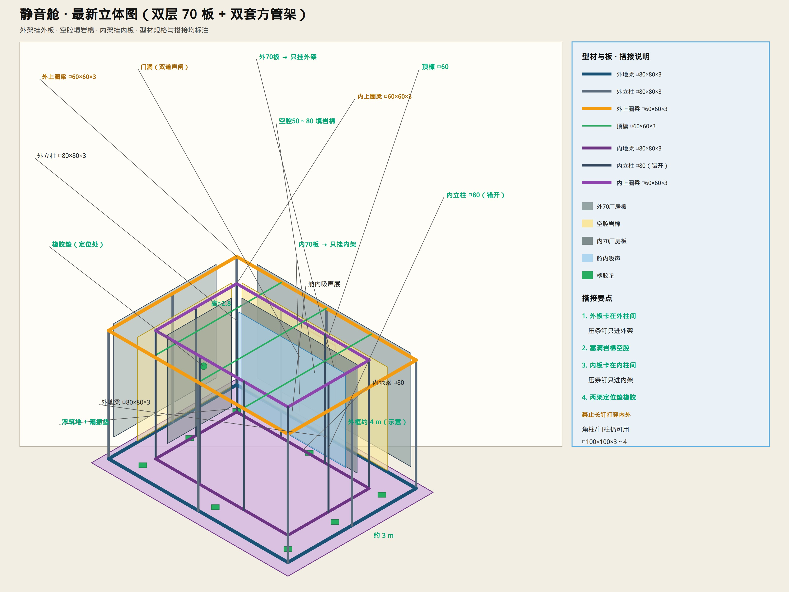

# 静音舱 · 最新立体图（型材 + 板搭接）

> 双套方管架 + 双层 70 mm 板。型材规格与搭接关系见图中标注。  
> 只保留示意图与说明。



---

## 型材一览

| 位置 | 型材 |
|------|------|
| 外地梁 / 外立柱 | **□80×80×3** |
| 外上圈梁 / 顶檩 | **□60×60×3** |
| 内地梁 / 内立柱 | **□80×80×3**（内柱与外柱**错开**） |
| 内上圈梁 | **□60×60×3** |
| 角柱 / 门柱 | **□100×100×3～4**（需要处） |

原来给你的那一套方管 = **外框架**；内框架按同样规格缩进一圈。

---

## 板怎么搭接（由外→内）

```text
外70厂房板 ──压条/钉──→ 只固定在外框架（外柱间、顶进外圈梁）
        ↓
空腔 50～80 mm 填岩棉（不承力）
        ↓
内70厂房板 ──压条/钉──→ 只固定在内框架
        ↓
舱内吸声层
```

- 两套框架都落在 **浮筑地 + 隔振垫** 上  
- 内外架必须靠近定位处：**垫橡胶**  
- **禁止**长钉从外板打穿到内板  

细部节点：[`DOUBLE_SKIN_FIXING.md`](./DOUBLE_SKIN_FIXING.md)  
整架单层原图：[`figures/54-full-steel-frame.jpg`](./figures/54-full-steel-frame.jpg)
