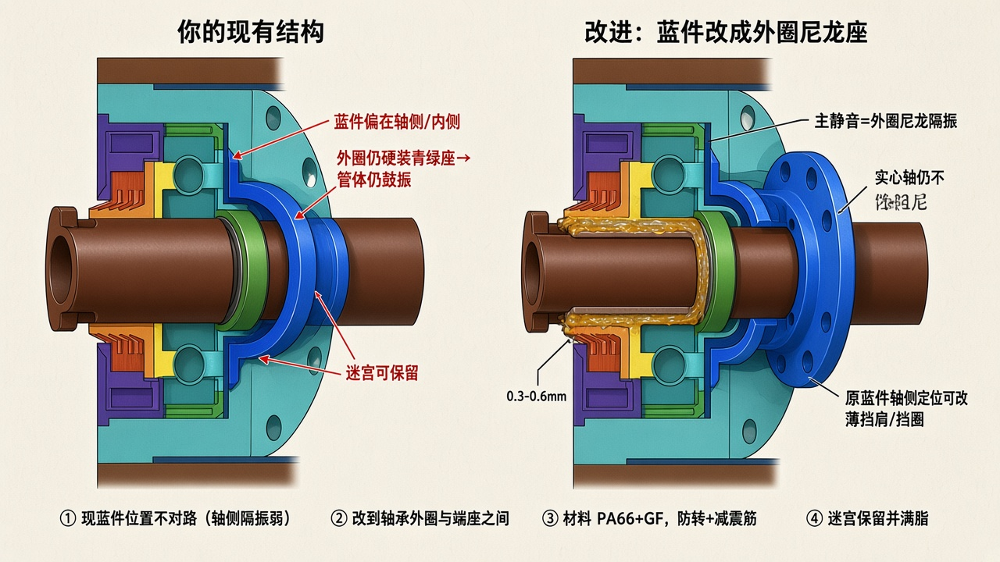

# 现有阻尼座能否改进？

> 依据你提供的 CAD 剖视（青绿端座 + 绿轴承 + 橙/紫迷宫 + **亮蓝件**）。  
> 原图：[`figures/ref-existing-damping-seat.jpg`](./figures/ref-existing-damping-seat.jpg)



---

## 结论

**可以改进，而且值得改。**  
你图里的亮蓝「阻尼座」多半在轴承**内侧/轴侧**起定位或局部缓冲；但绿色轴承**外圈仍直接坐在青绿端座孔里**——管体鼓振这条主路还在，所以静音效果有限。

---

## 现结构在干什么

| 零件 | 作用 | 对静音 |
|------|------|--------|
| 实心轴 | 固定承力 | 本身不做阻尼 |
| 绿轴承 | 回转 | 振源 |
| 青绿端座 | 抱轴承、连管 | 外圈硬装 → **传振到管** |
| 亮蓝件（现） | 偏轴侧/内侧 | 隔振弱，不是主路径 |
| 橙/紫迷宫 | 防尘 | 不隔振（可保留） |

```text
现路径：轴承外圈 ──硬接触──→ 青绿座 → 管体（鼓）
         蓝件在轴侧，帮不上大忙
```

---

## 怎么改蓝件

把亮蓝件改成 **真正的尼龙降噪座**：套在轴承**外圈**与青绿座孔之间。

- 外圈只进尼龙孔（减震筋），**不得再碰青绿座**  
- 尼龙外圆过盈进座孔，带防转  
- 材料用 PA66+GF（承力 + 隔振）  
- 原轴侧定位：改薄挡肩 / 挡圈即可，不必再当「主阻尼」  

```text
改进：轴承外圈 → ★尼龙蓝件★ → 青绿座 → 管体（振动被削弱）
      实心轴照旧贯穿，不做轴内阻尼
```

迷宫（橙/紫）保留：收间隙、满脂；最外可加一道轻贴软唇。端盖与支架留 **δ**。

---

## 一句话

现有蓝件不是不能用，是**装错了关键位置**；挪到（或重做成）轴承外圈隔振座，才是对静音真正有效的改进。
