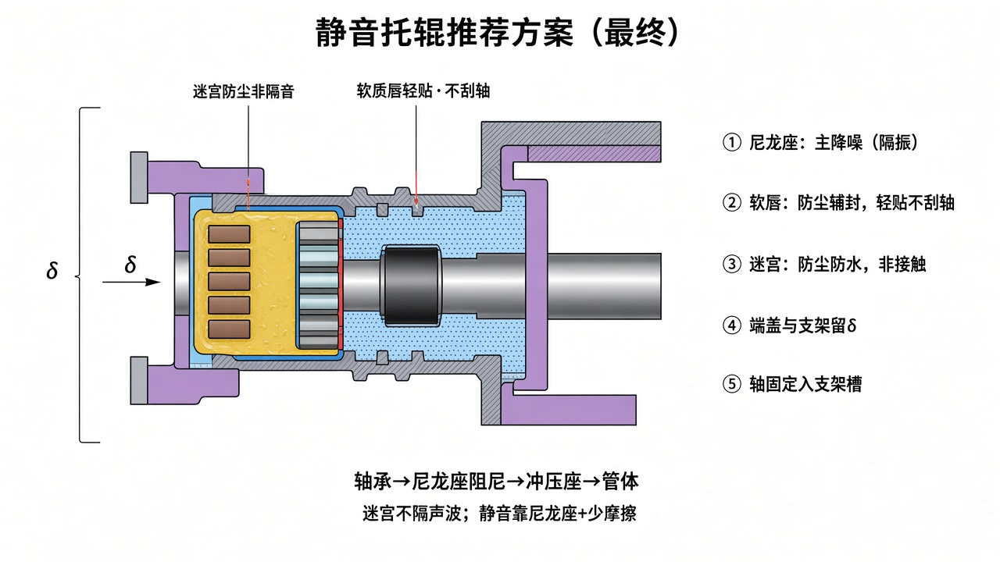

# 静音托辊推荐方案（最终版）

> 综合你提供的结构图与澄清：**软质唇轻贴、不刮轴**；尼龙座主降噪；迷宫管防尘而非隔音。  
> 竞品改进示意：[`IMPROVE_COMPETITOR.md`](./IMPROVE_COMPETITOR.md)  
> 彩色总图：[`figures/14-final-scheme-render.jpg`](./figures/14-final-scheme-render.jpg)



---

## 1. 方案一句话

**钢座承力 + 尼龙座隔振（主静音）+ 软质唇轻贴防尘（不刮轴）+ 非接触迷宫加强防尘 + 轴端入支架（端盖留间隙）。**

---

## 2. 各零件干什么（别混）

| 零件 | 材质/形态 | 转不转 | 真正作用 | 不是干什么 |
|------|-----------|--------|----------|------------|
| 轴 | 钢，扁位/六方入槽 | **不转** | 承力、定位 | — |
| 管体 | 精密焊管 | 转 | 托带 | — |
| 冲压轴承座 | 钢，焊于管端 | 转 | 承力骨架 | — |
| **尼龙降噪座** | PA66（建议+GF） | 转 | **主降噪**：隔断轴承→管体振动 | 不密封 |
| 轴承 | 深沟球，Z2/Z3、C3 | 内圈随轴/外圈转 | 回转；选低噪声 | — |
| **软质唇** | NBR 等弹性体 | 相对刮擦面轻贴 | **防尘辅封**，保护轴/对偶面 | **不隔声波**；不刮伤钢轴 |
| **迷宫** | PA/POM 定子+转子 | 定子不转/转子转 | **防尘防水**，非接触少摩擦 | **不隔声波** |
| 阻尼端盖 | HDPE/PA | 转 | 挡雨、降端面辐射 | 不承力、不顶支架 |
| 支架 | 槽钢 | 固定 | 只接轴端 | 与端盖留 **δ** |

### 降噪逻辑（必须清楚）

```text
主静音：轴承振动 → 尼龙座（软隔振）→ 传到管体变弱 → 管体不那么“鼓”
辅措施：软唇轻贴（少啸叫）+ 迷宫非接触（不额外摩擦）+ 端盖高分子
防尘：  软唇 + 迷宫 + 脂
隔音：  迷宫缝挡不住声波 —— 这是正常的，也不靠它隔音
```

---

## 3. 密封怎么定（按你的软唇前提）

### 推荐组合（稳妥静音）

```text
外侧 → 软质唇 1～2 道（轻贴，不刮轴）→ 迷宫 4～5 级（非接触+满脂）→ 轴承
```

- **软唇**：保留你“柔软、不刮轴”的做法；接触力要轻，宁少勿紧。  
- **迷宫**：定子在轴上（不转），转子在端盖上（转）；齿交错，间隙约 0.3～0.6 mm，满脂。  
- 不必强行改成“全硬迷宫、取消软唇”；软唇作辅封完全合理。

### 若维持多道软唇

也可：外侧 2 道软唇轻贴 + 内侧仍建议加几级非接触迷宫齿，静音与防尘更稳。

---

## 4. 配合（A/B/C）

| 代号 | 界面 | 要求 |
|------|------|------|
| A | 冲压座孔 / 尼龙座外圆 | 过盈 + 防转凸筋 |
| B | 尼龙座内孔 / 轴承外圈 | 减震筋过盈；**外圈不碰钢座** |
| C | 轴 / 轴承内圈 | 按轴承手册 |
| δ | 端盖外端面 / 支架 | 约数毫米级间隙，运转不碰 |
| 唇 | 软唇 / 对偶面 | 轻贴；材料软，不伤轴 |

---

## 5. 装配顺序（一端）

1. 冲压座与管体焊接、校圆  
2. 压入尼龙降噪座（防转对位）  
3. 轴承涂脂压入尼龙孔  
4. 轴上装迷宫定子 → 齿槽涂满脂  
5. 端盖内装迷宫转子（及软唇）  
6. 合装对齿，手转灵活、无刮蹭啸叫  
7. 挡圈定位；保证轴伸与 δ  
8. 动平衡；阻力/噪声抽检  

---

## 6. 你该听什么效果

| 预期 | 原因 |
|------|------|
| 比“轴承硬装钢座”明显更静 | 尼龙座隔振 |
| 比“多道紧接触硬刮”更不易啸叫 | 软唇轻贴 + 迷宫非接触 |
| 不会出现“迷宫把声音封死” | 迷宫本来就不隔音 |

现场对比：同规格普通托辊 vs 本方案，空载旁听/声级计即可；验收也可参考 GB/T 10595、MT/T 821 的阻力与密封试验。

---

## 7. 相关图与出处

| 内容 | 文件 |
|------|------|
| 本方案总图 | [`figures/14-final-scheme-render.jpg`](./figures/14-final-scheme-render.jpg) |
| 冲压座+尼龙座风格参考 | [`figures/ref-user-preferred-style.jpg`](./figures/ref-user-preferred-style.jpg) |
| 迷宫认件与装配（清楚版） | [`figures/13-labyrinth-clear-render.jpg`](./figures/13-labyrinth-clear-render.jpg) |
| 出处分级 | [`REFERENCES.md`](./REFERENCES.md) |
