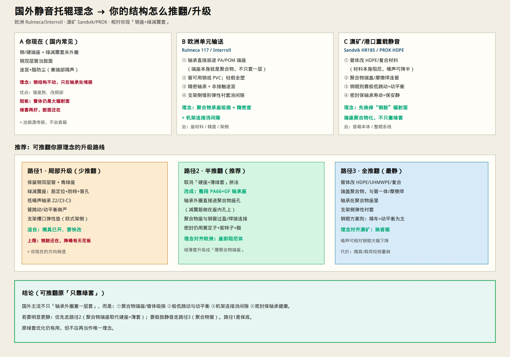
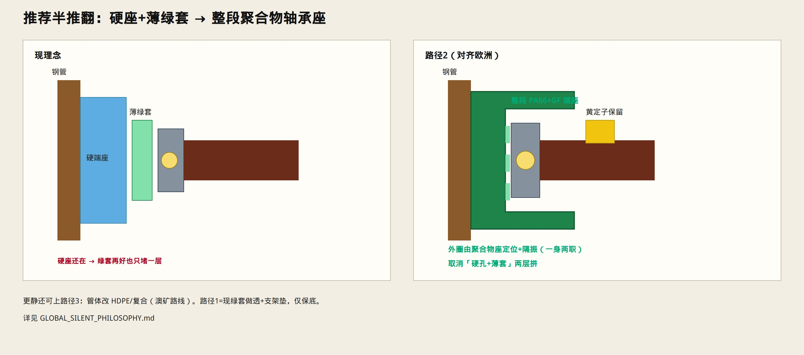
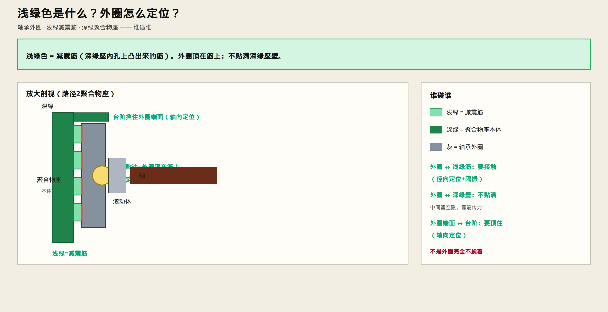

# 国外静音托辊理念 → 你的结构如何推翻/升级

> 对照欧洲、澳矿主流做法，重新审视「只靠绿减震套」是否够。  
> 可以推翻原设计理念。只保留示意图与说明。







> **浅绿** = 减震筋；**深绿** = 聚合物座本体。外圈顶在筋上定位，不贴满深绿座壁；轴向靠台阶挡住。  
> **细部结构：** [`RIB_SEAT_DETAIL.md`](./RIB_SEAT_DETAIL.md)

---

## 国外在想什么（和你现在的差别）

| 地区/代表 | 核心理念 | 和你现结构的差别 |
|-----------|----------|------------------|
| **欧洲单元** Rulmeca 117、Interroll | 轴承装进 **PA/聚合物端座**；精密轴承；非接触迷宫；**支架侧弹性衬套消间隙** | 端座本身是阻尼体，不是硬座里再塞薄绿套 |
| **澳矿/港口** Sandvik HR185、PROK HDPE | **HDPE/复合管体**吸振（宣称可比钢辊噪声降一半量级）；聚合物端盖与管一体/摩擦焊；密封保轴承寿命 | 先换掉钢鼓「音箱」，不只堵轴承传振 |
| **钢辊低噪声** Sandvik HR150 等 | 极低跳动（TIR）+ 动平衡，从振源几何下手 | 管圆度和平衡是一等公民 |
| **你现在** | 钢双层管 + 硬端座 + **绿减震套**夹外圈 + 迷宫满脂 + 深蓝热补偿 | 钢音箱还在，主要在轴承处堵振 |

公开产品页可参考：  
[Rulmeca 117/HX](https://www.rulmeca.com/en/117hx/360/p) · [Rulmeca HDPE SUPREME](https://www.rulmeca.com/en/hdpe-high-density-polyethylene-rollers---supreme/20/p) · [Sandvik composite rollers](https://www.australianmining.com.au/sandvik-releases-new-conveyor-composite-rollers/) · [PROK HDPE](https://prok.com/global-product/prok-hdpe/)

---

## 原理念哪里不够

```text
原理念：钢结构不动 → 绿套切断外圈→座传振 → 更静
国外补充：辐射面（管）也是噪声主角；端座材料、跳动、机架间隙同样关键
```

绿套优化（筋定位、防转、盲孔）**仍然有效**，但不应再当作唯一静音哲学。

---

## 三条路径（可推翻）

### 路径1 · 局部升级（少推翻）

- 保留钢双层管 + 现端座骨架  
- 绿减震座按 [`DAMPER_SEAT_QUIETER.md`](./DAMPER_SEAT_QUIETER.md) 做透（筋定位，不是悬空）  
- 低噪声轴承、管跳动/平衡做严  
- **加上欧式：支架槽口弹性垫**  
- 适合模具已开；降噪有天花板（钢鼓还在）

### 路径2 · 半推翻（推荐）

- **取消「硬座 + 薄绿套」拼法**  
- 改为整段 **PA66+GF 聚合物轴承座**：外圈直接进座内孔（内孔自带减震筋）  
- 聚合物座与钢管过盈/焊接连接  
- 黄封公 + 紫转子 + 脂密封可保留  
- 对齐欧洲：**座即阻尼体**

### 路径3 · 全推翻（最静）

- 管体改 **HDPE / UHMWPE / 复合**  
- 聚合物端盖与管一体或摩擦焊  
- 支架侧弹性衬套  
- 对齐澳矿：**先换音箱**  
- 代价：载荷、温升、模具体系重做

---

## 建议你怎么选

| 目标 | 选 |
|------|----|
| 最快出样、少改模具 | 路径1 |
| **明显更静、仍用钢管** | **路径2** |
| 港口/居民区/要大幅降噪 | 路径3 |

颜色与现件认件仍见 [`COLOR_LEGEND.md`](./COLOR_LEGEND.md)、[`COMPLETE_BEARING.md`](./COMPLETE_BEARING.md)。
