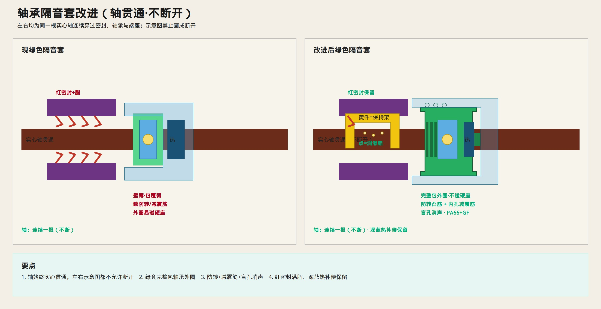

# 轴承隔音套（绿色）改进

> 依据你 CAD 里包在轴承外圈的绿色消音/隔振套。  
> **外圈—座隔振套专页（轴承画全）：** [`OUTER_RACE_ISOLATOR.md`](./OUTER_RACE_ISOLATOR.md)  
> 总原理：[`SILENT_SEAT_PRINCIPLE.md`](./SILENT_SEAT_PRINCIPLE.md)  
> 只保留示意图与说明。



> 轴为**实心贯通**，示意图左右两侧均为连续一根轴（此前误画成断开，已改正）。

---

## 现结构在干什么

绿色件＝**轴承隔音套 / 消音套**：套在轴承外圈外，阻隔、吸收轴承噪声，并尽量避免外圈与硬座硬碰。

常见短板（对照你现图常见形态）：

- 包覆偏薄或不完整 → 外圈仍可能局部碰硬座  
- 缺防转 → 套与座相对打滑，啸叫、发热  
- 内孔光面硬抱 → 阻尼弱于「减震筋」接触  
- 少消声结构（筋间空腔 / 盲孔）→ 吸声路径短  

---

## 改进怎么改

**做成完整的尼龙降噪消音座：包死外圈 + 防转 + 减震筋 + 消声腔。**

```text
轴承外圈 → 绿套内孔减震筋（过盈轻抱）
         → 绿套本体（PA66+GF，阻尼）
         → 外圆过盈 + 防转凸筋进端座
         → （翻边/盲孔消声）→ 端座 / 管
外圈任何一点不得再碰硬座
```

| 改什么 | 做法 |
|--------|------|
| 包覆 | 外圈周向、端面关键接触面都隔开硬座 |
| 内孔 | 均布 **减震筋** 抱外圈（少实面接硬传） |
| 外圆 | 过盈进座孔 + **防转凸筋/卡槽** |
| 消声 | 翻边或外沿开 **盲孔/消声腔**，加长声反射路径 |
| 材料 | **PA66+GF**（承力 + 阻尼）；过薄纯软胶易蠕变 |
| 红密封 / 深蓝 | **不动**（满脂端部隔声、热补偿照旧） |

---

## 和另外两路的关系

| 路径 | 零件 | 改进后 |
|------|------|--------|
| 结构隔振 + 吸声 | **绿隔音套** | 本页加强 |
| 端部隔声 + 防尘 | 红迷宫 + 满脂 | 见 [`RED_SEAL_IMPROVE.md`](./RED_SEAL_IMPROVE.md) |
| 热变形 | 深蓝软件 | 保留，见 [`DARK_BLUE_THERMAL.md`](./DARK_BLUE_THERMAL.md) |

绿套是结构隔振主件；改好它，管体鼓振会明显下来，再配合红区满脂与深蓝热补偿。

公开专利同类表述：降噪座隔开轴承与冲压座；消音套包轴承并防相对转动；外沿盲孔加长声路（如复合式静音托辊、非金属低噪音托辊相关专利）。
