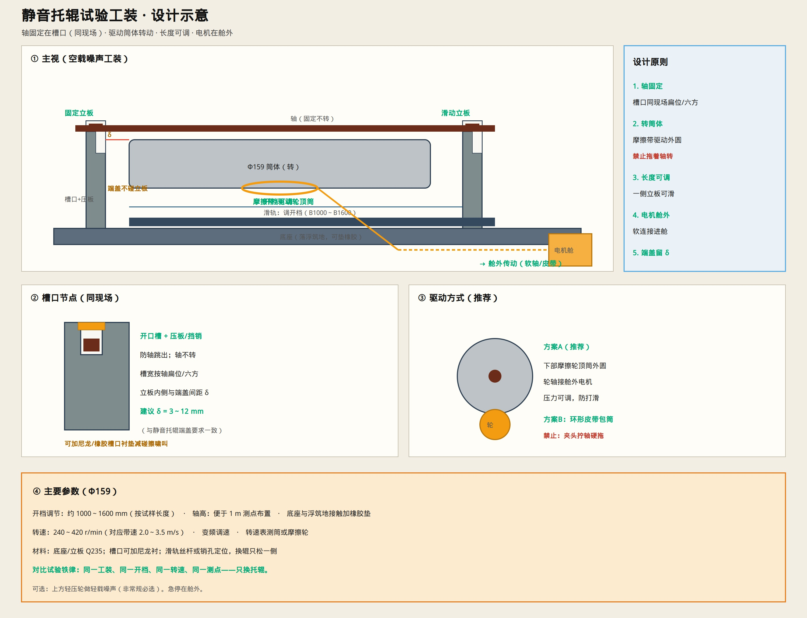

# 静音托辊试验工装 · 设计

> 用途：隔音舱内做 Φ159 空载噪声对比。  
> 核心：**轴固定、筒转动**（与现场一致），长度可调，电机舱外。  
> 只保留示意图与说明。



---

## 一句话

两边立板开槽托住轴（同现场槽口）→ 摩擦轮/皮带驱动**筒体外圆**转动 → 一侧立板可滑调开档 → 电机在舱外软连接进来。

---

## 设计原则（必须守）

| # | 原则 | 说明 |
|---|------|------|
| 1 | **轴固定** | 扁位/六方入槽 + 压板，轴不转 |
| 2 | **转筒体** | 驱动作用在筒外圆，**禁止夹轴硬拖** |
| 3 | **开档可调** | 一侧滑动立板，覆盖约 B1000～B1600 |
| 4 | **端盖留 δ** | 立板内侧与端盖 **3～12 mm**，禁止碰擦 |
| 5 | **电机舱外** | 摩擦轮轴用皮带/软轴接驱动隔间 |
| 6 | **对比铁律** | 同工装、同开档、同转速、同测点，只换辊 |

---

## 结构组成

```text
底座（落浮筑地，可垫橡胶）
  ├─ 固定立板：开口槽 + 压板/挡销
  ├─ 滑动立板：同槽口，沿滑轨调开档 L
  ├─ 滑轨 / 销孔定位（调好锁死）
  └─ 驱动模块：下部摩擦轮（推荐）顶筒外圆
         └─ 传动穿出 → 舱外变频电机
```

| 件 | 建议 |
|----|------|
| 底座 / 立板 | Q235；焊或螺栓 |
| 槽口 | 按轴扁位/六方；可加尼龙/橡胶衬减啸叫 |
| 滑轨 | 丝杆调节或销孔分档 |
| 摩擦轮 | 聚氨酯/橡胶面，压力可调 |
| 轴高 | 便于布置上方/侧方 **1 m** 测点 |

---

## 驱动两种做法

| 方案 | 做法 | 选用 |
|------|------|------|
| **A 推荐** | 下部摩擦轮顶筒外圆，轮轴接舱外电机 | 装卸快、少改试样 |
| B | 环形皮带包筒传动 | 也可，注意皮带噪声 |
| × 禁止 | 夹头拧轴、让轴带着轴承反拖 | 工况与现场相反，噪声失真 |

转速：Φ159 约 **240～420 r/min**（带速 2.0～3.5 m/s），变频可调；转速表测筒或测摩擦轮。

---

## 使用步骤

1. 按试样长度调开档，锁死滑动立板  
2. 轴落入槽口，上压板；检查端盖与立板间隙 δ  
3. 摩擦轮轻顶筒体，舱外电机点动确认转向、无碰擦  
4. 关门 → 升至目标转速 → 按固定测点测噪声  
5. 停机换对比辊/静音辊，**不改开档与测点**  

急停按钮在舱外。可选上方轻压轮做轻载噪声（非必须）。

---

## 与实验室关系

- 工装整机压在 **浮筑地** 上（[`LAB_FLOOR.md`](./LAB_FLOOR.md)）  
- 电机进 **驱动隔间**（[`SILENT_LAB_STANDARD.md`](./SILENT_LAB_STANDARD.md)）  
- 测序见 [`TEST_TOOLS_ENV.md`](./TEST_TOOLS_ENV.md)  
- 列入完备总册：[`SILENT_LAB_PACK.md`](./SILENT_LAB_PACK.md)

多规格开口槽（可换衬块）：[`MULTI_SIZE_SLOT.md`](./MULTI_SIZE_SLOT.md)
