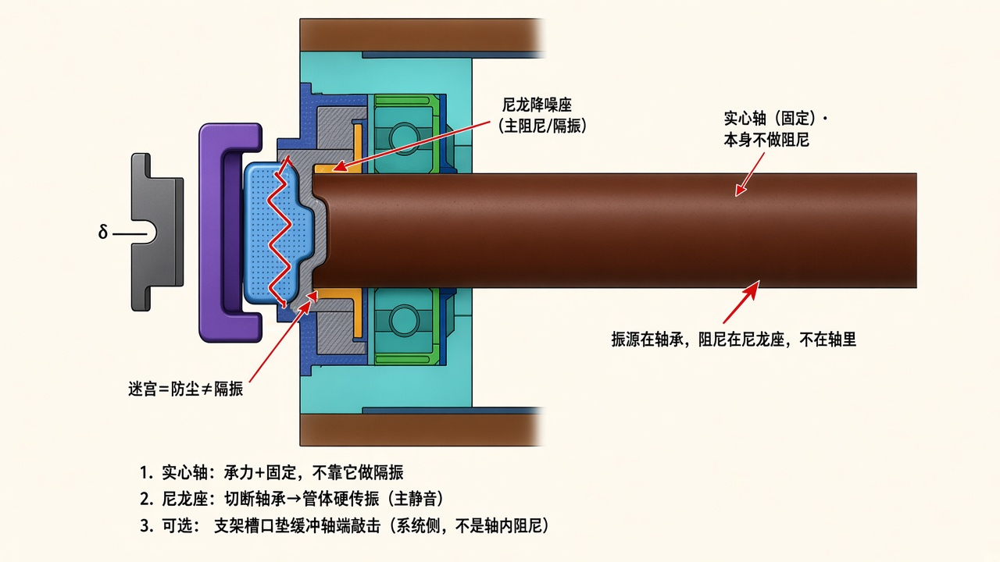
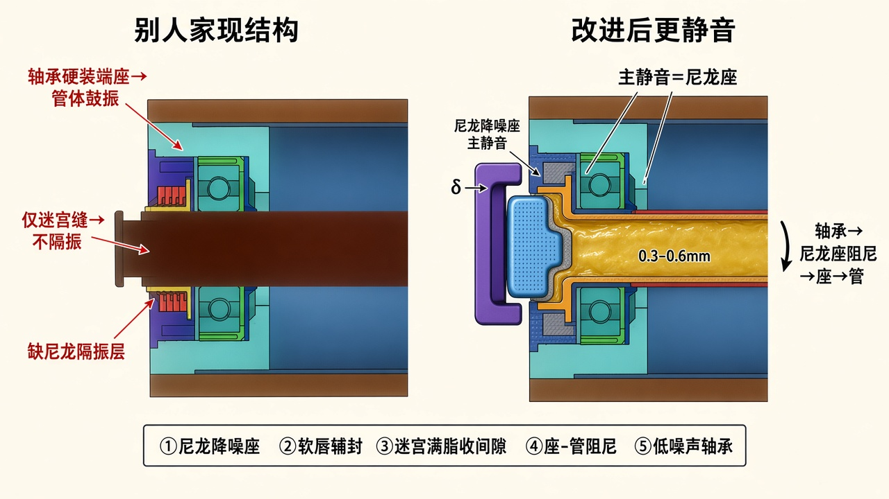

# 竞品静音托辊 → 更静音改进

> 对象：你 CAD 中的静音轴承座（绿消音隔振 / 红迷宫+脂 / 深蓝热补偿）。  
> 只保留示意图与说明。  
> **原理纠正（先看这个）：** [`SILENT_SEAT_PRINCIPLE.md`](./SILENT_SEAT_PRINCIPLE.md)  
> 红密封改进：[`RED_SEAL_IMPROVE.md`](./RED_SEAL_IMPROVE.md) · **绿隔音套改进：** [`GREEN_MUFFLER_IMPROVE.md`](./GREEN_MUFFLER_IMPROVE.md) · 深蓝热补偿：[`DARK_BLUE_THERMAL.md`](./DARK_BLUE_THERMAL.md)





---

## 实心轴怎么做阻尼？

**不做。** 中间是实心钢轴，固定不转，作用是承力、定位进支架槽——**不在轴里挖空、不包胶、不靠轴本身隔振。**

噪声主路径是：轴承滚道振动 → 外圈 → 端座 → 管体鼓响。  
所以阻尼加在 **轴承外圈与青绿端座之间的尼龙降噪座**，切断硬传振；不是改实心轴。

| 部位 | 做什么 |
|------|--------|
| 实心轴 | 承力 + 固定；本身不做阻尼 |
| 尼龙降噪座 | **主阻尼/隔振**（轴承外圈侧） |
| 软迷宫 | 防尘，≠隔振 |
| 支架槽口垫（可选） | 只缓冲轴端敲击，属支架侧，不是轴内阻尼 |

---

## 别人家哪里吵

轴承外圈直接硬装在青绿端座里，振动传到管体，管体像鼓。黄/紫软迷宫主要挡灰，几乎不隔振。

## 怎么改更静

在绿色轴承外圈和青绿端座之间加 **尼龙降噪座**（主静音）。软迷宫保留并满脂；可加软唇、座—管薄阻尼；端盖与支架留 **δ**。

```text
支架 |δ| 端盖 → 软唇 → 软迷宫 → 轴承 → ★尼龙座★ → 端座 → 管
              ↑
         实心轴贯穿（固定，不做阻尼）
```
