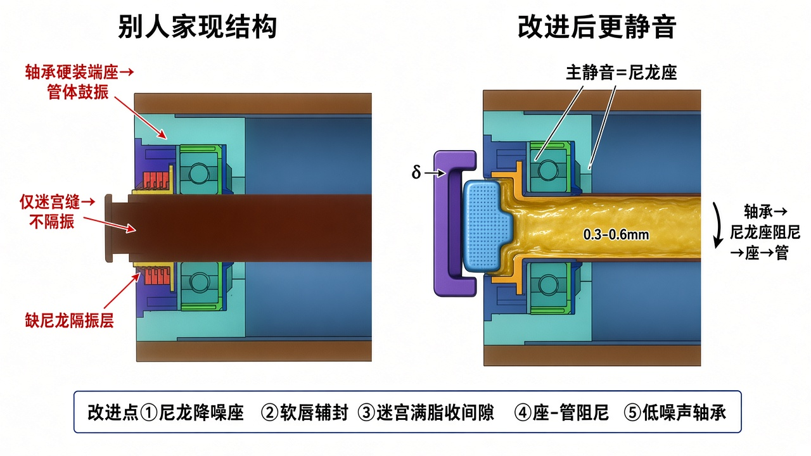

# 竞品静音托辊 → 更静音改进方案

> 对象：你提供的别人家 CAD（双层管 + 青绿端座硬装轴承 + 黄/紫软迷宫）。  
> 对比图：[`figures/15-competitor-vs-improved-render.jpg`](./figures/15-competitor-vs-improved-render.jpg)



---

## 1. 别人家结构（读图结论）

| 零件（按你图颜色） | 作用 |
|--------------------|------|
| 棕外套 + 蓝内衬 | 双层管体 |
| 青绿端座 | 轴承座，压入管端 |
| 绿色轴承 | 深沟球轴承，**外圈直接坐在端座孔内** |
| 黄/橙软件 + 紫件 | 软质迷宫（不刮轴）——防尘为主 |
| 深红轴 | 贯穿，端头外伸入支架 |

**已有优点（可保留）**

- 软质迷宫，不伤轴  
- 双层管，有一定结构刚度/隔振潜力  
- 多级齿交错，防尘思路对  

**静音短板（要打的点）**

1. **轴承硬装端座** → 振动直接传管体，管体当鼓（这是最大噪声源路径）  
2. **只有迷宫缝** → 挡灰尘，**几乎不隔振、不隔声波**  
3. 迷宫间隙偏大、未见满脂 → 防尘与缝隙阻尼都偏弱  
4. 端座与管体偏刚性耦合 → 缺弹性隔振层  
5. 未见明确低噪声轴承等级与端面阻尼盖  

---

## 2. 改进目标

在**少改外形、可兼容现模具思路**的前提下，明显压低噪声：

> **主攻：切断「轴承 → 管体」硬传振；辅攻：少摩擦啸叫、护轴承、弱化端面辐射。**

---

## 3. 改进清单（按静音收益排序）

### ① 必做：加尼龙降噪座（主静音）★

在绿色轴承外圈与青绿端座之间加 **PA66+GF 尼龙降噪座**：

- 翻边轴向定位 + **防转凸筋**  
- 内孔 **减震筋** 抱轴承外圈  
- **轴承外圈不得再与硬端座直接接触**

效果：打断钢/硬座硬传振，管体鼓振明显下降——这是相对竞品最关键的差距。

### ② 必做：低噪声轴承 + 脂

- 轴承明确 **低噪声级 Z2/Z3**，游隙 **C3**  
- 充脂约轴承空隙 **40%～60%**（GB/T 10595）  
- 可用低噪声锂基脂  

### ③ 保留并优化：软迷宫（你现有亮点）

- **保留软质、不刮轴**  
- 齿间间隙收到约 **0.3～0.6 mm**  
- **空隙充满润滑脂**（脂障 + 微量粘滞阻尼）  
- 动静分清：轴上软件＝定子（不转），端盖侧＝转子（转）  

### ④ 建议加：外侧 1 道软唇轻贴

在迷宫最外侧加 **一道**软质唇轻贴对偶面：

- 挡粗颗粒，减轻迷宫负担  
- 只一道、接触要轻，避免啸叫  
- 与“不刮轴”不冲突  

### ⑤ 建议加：端座—管体阻尼

青绿端座与蓝内衬/棕管之间加：

- 薄层 **弹性阻尼套/阻尼胶**，或  
- 局部橡胶/TPE 环  

避免端座把振动硬传到管壁。

### ⑥ 建议加：高分子阻尼端盖 + 支架间隙 δ

- 端盖用 HDPE/PA，降端面辐射  
- 与支架立板留 **δ**，禁止碰擦  

### ⑦ 可选加强（冲击更大时）

- 管体内壁阻尼涂层 / 近端部阻尼环（注意动平衡）  
- 受料点另用包胶辊，不改本端部模块  
- 双层管夹层加薄粘弹层（若可改管结构）  

---

## 4. 改进后结构（一端）

```text
支架 |δ| 阻尼端盖
        → 软唇×1（轻贴）
        → 软迷宫（定子@轴 + 转子@盖，满脂）
        → 轴承（Z2/Z3·C3）
        → ★尼龙降噪座★
        → 端座（可保留竞品青绿座外形）
        → （阻尼层）→ 双层管体
轴固定，扁位入支架槽
```

---

## 5. 和竞品对比（你怎么赢）

| 项目 | 别人家 | 改进后 |
|------|--------|--------|
| 轴承安装 | 硬装端座 | **尼龙座软隔振** |
| 迷宫 | 有，软质不刮轴 | **保留** + 收间隙 + 满脂 |
| 外唇 | 无/弱 | **一道轻贴软唇** |
| 座—管 | 刚性 | **加阻尼层** |
| 端盖 | 一般 | **高分子 + δ** |
| 降噪主路径 | 几乎只靠密封缝 | **隔振为主，密封为辅** |

预期：同工况下空载噪声可比竞品再低一截（现场用声级计/旁听对比）；具体 dB 以台架为准。

---

## 6. CAD 改模要点（对着你装配体）

1. `青绿端座` 轴承孔加大 → 压入尼龙降噪座  
2. 轴承改装尼龙孔，校核防转、轴向挡圈  
3. 黄/紫迷宫：校间隙、加注脂槽/满脂工艺  
4. 最外加软唇环（可与紫件一体硫化/卡装）  
5. 端座外圆与蓝内衬间加阻尼套  
6. BOM 写明轴承噪声级、脂牌号  

---

## 7. 验收建议

- 与竞品同台：空载转速、测点 1 m 声压级  
- 旋转阻力不高于竞品  
- 迷宫内外件不接触；软唇不伤轴  
- 淋水/粉尘后阻力无明显恶化（可对标 MT/T 821）  
