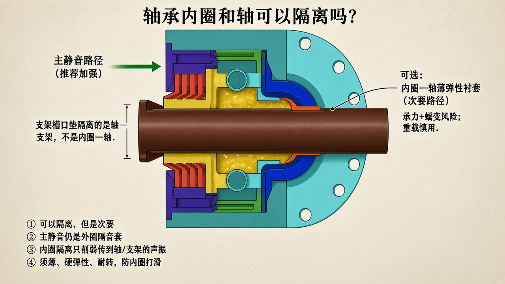

# 轴承内圈和轴可以隔离吗？

> 只保留示意图与说明。  
> 总原理：[`SILENT_SEAT_PRINCIPLE.md`](./SILENT_SEAT_PRINCIPLE.md)



---

## 结论

**可以，但是次要。**  
能在内圈与轴之间加薄弹性/聚合物衬套，削弱传到轴、再到支架的振动；  
**管体鼓振这条主路仍靠绿色外圈隔音套**，内圈隔离替不了它。

---

## 两条路别混

| 路径 | 界面 | 作用 | 建议 |
|------|------|------|------|
| **主静音** | 轴承**外圈** ↔ 绿隔音套 ↔ 端座/管 | 切断传到管体的振动 | **优先加强** |
| **次要** | 轴承**内圈** ↔ 衬套 ↔ **轴** | 削弱传到轴/支架的声振 | 可选，轻中载可试 |
| 支架侧 | 轴端 ↔ 槽口垫 ↔ 支架 | 降轴端敲击 | 常用、稳妥 |

你现在的轴是固定的：内圈本来就跟着轴不转。隔离的是**径向/轴向弹性**，不是让内圈在轴上打滑转。

---

## 若做内圈—轴隔离，要注意

- 衬套要**薄**、用较硬弹性体或薄壁工程塑料（如薄壁 PA/PU），别用很软很厚的胶  
- **防转、防蠕变**：内圈不能在轴上相对转磨，否则发热啸叫  
- 同轴度、游隙会变：装完要手转灵活、无周期性异响  
- **重载托辊慎用**：载荷全经内圈进轴，软层易蠕变松旷  

更稳妥的「轴侧降噪」往往是：**支架槽口加尼龙/橡胶垫**（隔离轴—支架），不动轴承配合。

---

## 和你现有件的关系

- 金黄封公、红唇+脂、深蓝热补偿、绿隔音套：**都可以保留**  
- 若加内圈衬套：不要和金黄定子内孔抢位、别把轴配合弄松  

```text
推荐优先级：
1. 绿外圈隔音套（主）
2. 红迷宫满脂（端部隔声）
3. 支架槽口垫（轴—架）
4. 内圈—轴薄衬套（可选、次要）
```
