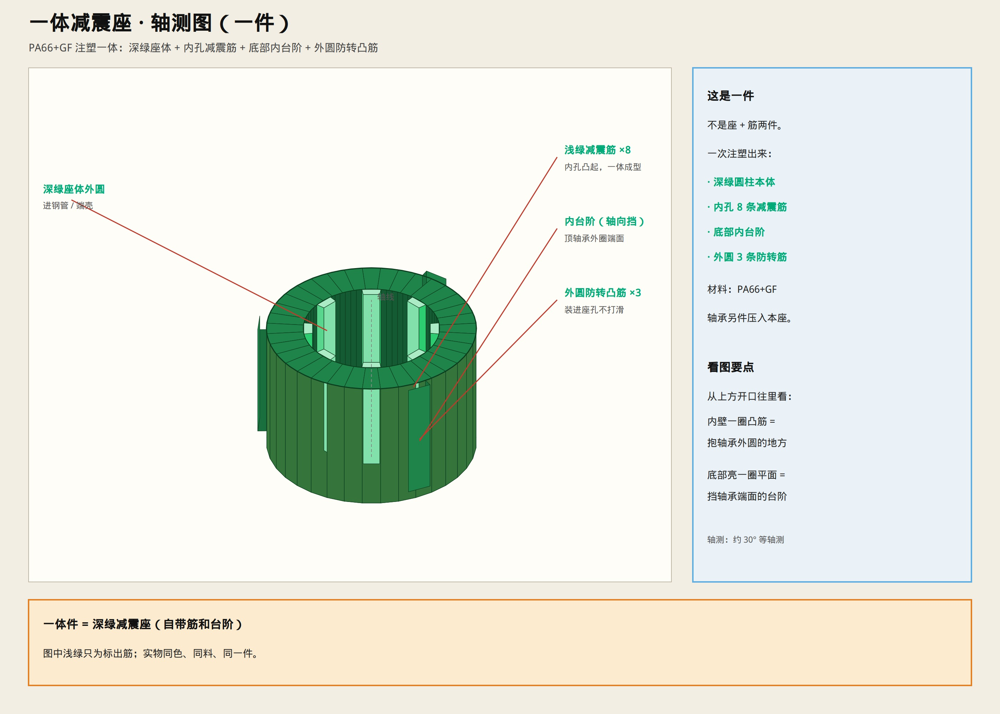

# 一体减震座 · 轴测图

> **一件**注塑件（PA66+GF）。浅绿只是标出减震筋，实物同料同色。

---

## 这一件上有什么

| 结构 | 干什么 |
|------|--------|
| 深绿圆柱本体 | 外圆进钢管/端壳 |
| 内孔 8 条减震筋 | 抱轴承外圆（径向定位+隔振） |
| 底部内台阶 | 挡轴承外圈端面（轴向定位） |
| 外圆 3 条防转凸筋 | 装进座孔后不打滑啸叫 |

轴承是**另一件**，压进本座。
