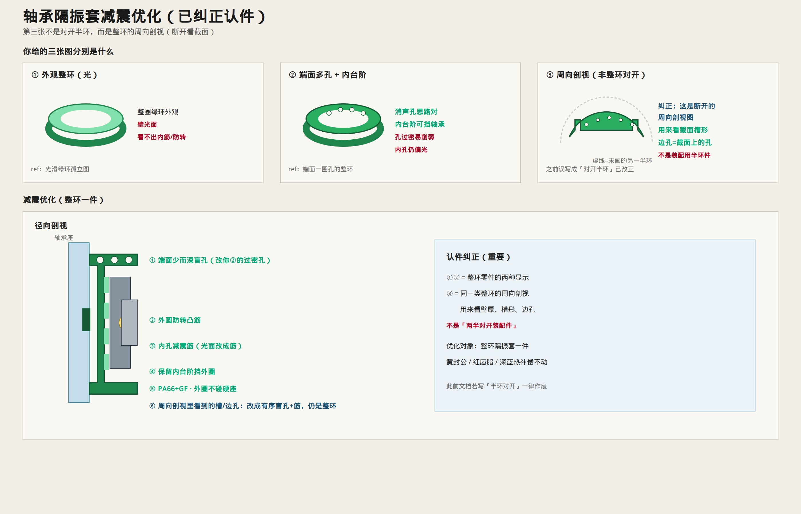

# 轴承隔振套减震优化

> 对着你孤立显示的绿套零件。  
> **纠正：** 第三张不是「对开半环」，而是**整环的周向剖视（断开看截面）**。  
> 原图：[`ref-isolator-v2-plain.jpg`](./figures/ref-isolator-v2-plain.jpg) · [`ref-isolator-v1-holes.jpg`](./figures/ref-isolator-v1-holes.jpg) · [`ref-isolator-v3-half.jpg`](./figures/ref-isolator-v3-half.jpg)（周向剖视）



---

## 三张图分别是什么

| 图 | 实际是什么 | 说明 |
|----|------------|------|
| ① 光环 | 整环外观 | 壁光面，结构减震特征少 |
| ② 端面多孔 + 内台阶 | 整环外观/端视 | 消声孔思路对；孔易过密；内孔偏光 |
| ③ 弧形断开件 | **整环周向剖视** | 用来看截面槽形、边孔；**不是装配用两半** |

---

## 减震怎么优化（整环一件）

以②为主，结合③剖视看到的槽/孔信息：

```text
① 端面：少而深的盲孔（改过密小孔）
② 外圆：防转凸筋 → 轴承座槽
③ 内孔：周向减震筋抱轴承外圈
④ 内台阶：保留，挡外圈
⑤ 材料：PA66+GF；外圈不得碰硬座
```

```text
外圈振动 → 减震筋吸能 → 套体阻尼 + 盲孔耗声 → 轴承座（削弱）
```

黄封公、红唇满脂、深蓝热补偿先不动。
