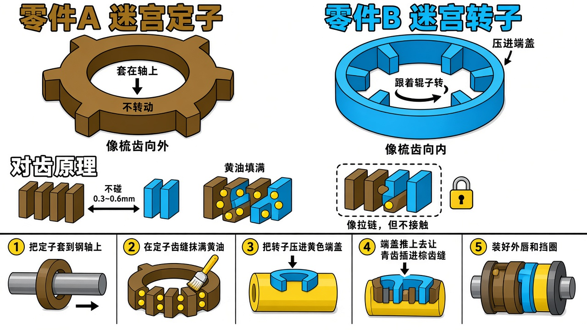

# 迷宫定子 / 转子单件与装配

> **推荐先看（更清楚）：** [`figures/13-labyrinth-clear-render.jpg`](./figures/13-labyrinth-clear-render.jpg) · [`figures/13-labyrinth-clear.png`](./figures/13-labyrinth-clear.png)
>
> 详细版：[`figures/12-labyrinth-parts-assembly-render.jpg`](./figures/12-labyrinth-parts-assembly-render.jpg)

---

## 1. 迷宫定子（单件）

| 项目 | 说明 |
|------|------|
| 作用 | 形成迷宫的**固定齿** |
| 安装位置 | **轴**上（过盈 / 台肩 / 挡圈） |
| 运动 | **不转** |
| 结构 | 内孔配轴 + 向外伸出的多道齿（常用 4～5 齿） |
| 材料 | PA6 / POM（常见） |

## 2. 迷宫转子（单件）

| 项目 | 说明 |
|------|------|
| 作用 | 形成迷宫的**转动齿** |
| 安装位置 | **端盖 / 密封座**内孔 |
| 运动 | **随辊转动** |
| 结构 | 外圆配端盖 + 向内伸出的多道齿，与定子齿交错 |
| 材料 | PA6 / POM（常见） |

## 3. 合装关系

- 转子齿插入定子齿槽，**交错**形成曲折通道  
- 齿间间隙约 **0.3～0.6 mm**，**不得接触**（MT/T 821）  
- 空隙 **充满润滑脂**  

## 4. 装配顺序（一端）

1. **轴上装定子** → 清洁、涂脂、轴向定位  
2. **定子齿槽涂满脂**  
3. **端盖内压入转子**（保证与端盖同转）  
4. **合装**：端盖组件推入，转子齿插入定子齿槽，检查无刮蹭  
5. **装单道轻接触外唇 + 挡圈**，手转灵活  

## 5. 检查

- [ ] 定子在轴上不转、不窜  
- [ ] 转子随端盖转  
- [ ] 无刮擦啸叫  
- [ ] 脂已充满  
- [ ] 外唇仅轻接触  
