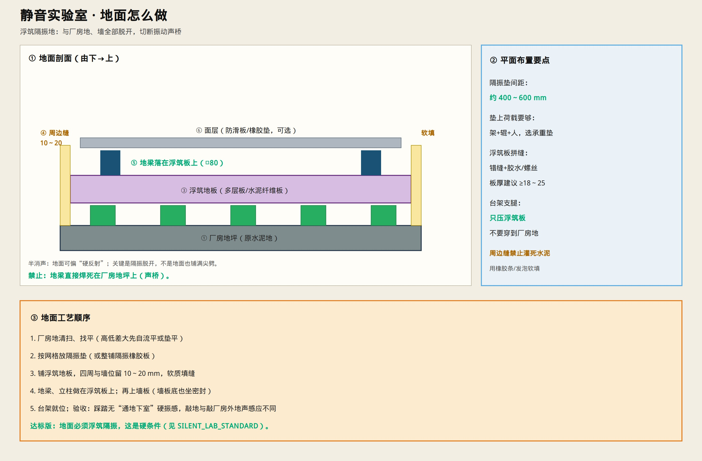

# 静音实验室 · 地面怎么做

> 达标硬条件：**浮筑隔振地**，与厂房地、墙全部脱开。  
> 只保留示意图与说明。

---

## 一句话

厂房地上铺隔振垫 → 再铺浮筑地板 → 地梁和台架都压在浮筑板上；**四周留缝软填，禁止焊死/灌死在厂房上。**

---

## 层次（由下→上）

| 层 | 做法 | 要点 |
|----|------|------|
| ① 厂房地坪 | 原水泥地，清扫找平 | 高低差大先垫平 |
| ② 隔振 | 橡胶隔振垫 / 弹簧隔振器，或整铺隔振橡胶板 | 间距约 **400～600 mm**；承重够（架+辊+人） |
| ③ 浮筑地板 | 多层板或水泥纤维板，厚约 **18～25 mm** | 错缝拼装 |
| ④ 周边缝 | 与墙位留 **10～20 mm** | **橡胶条/发泡软填**，禁止灌水泥 |
| ⑤ 地梁 | □80 落在浮筑板上 | 不直接焊厂房地坪 |
| ⑥ 面层（可选） | 防滑板 / 橡胶垫 | 半消声地面可偏硬，不必铺尖劈 |

---

## 工艺顺序

1. 清扫、找平厂房地  
2. 按网格放隔振垫（或整铺隔振板）  
3. 铺浮筑地板，四周留缝软填  
4. 地梁、立柱做在浮筑板上，再上墙  
5. 台架支腿只压浮筑板，**不要穿到厂房原地面**  

---

## 验收

- 踩踏：不应像踩在“通厂房大地板”上硬振  
- 台架运转：振动不明显传到舱外地坪  
- 周边缝：软质，墙板底有密封，无刚性搭接  

达标总要求：[`SILENT_LAB_STANDARD.md`](./SILENT_LAB_STANDARD.md)  
总工艺：[`SILENT_LAB_BUILD.md`](./SILENT_LAB_BUILD.md)
