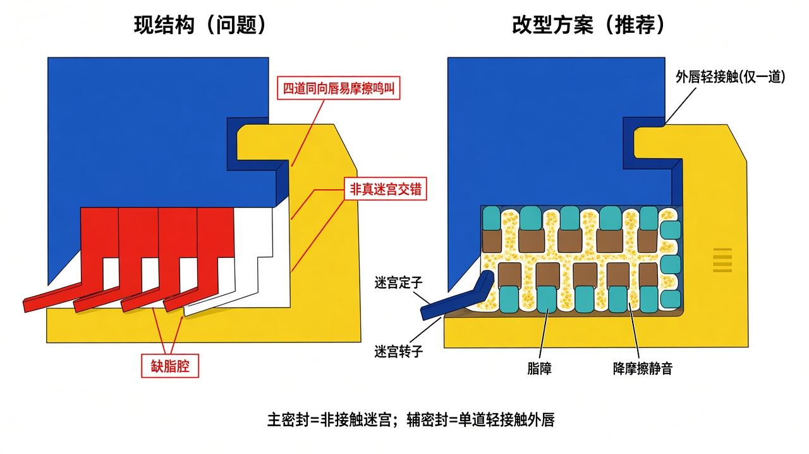

# 唇型密封改型说明

> 针对 CAD 截图 [`figures/ref-lip-seal-cad.jpg`](./figures/ref-lip-seal-cad.jpg)（四道同向红斜唇）。  
> 对比图：[`figures/11-lip-seal-redesign-render.jpg`](./figures/11-lip-seal-redesign-render.jpg) · [`figures/11-lip-seal-redesign.png`](./figures/11-lip-seal-redesign.png)



---

## 1. 现结构问题

| 现象 | 风险 |
|------|------|
| 四道同向斜唇 | 若都接触 → 摩擦热、啸叫、阻力大（静音失败） |
| 若四道都留大间隙 | 只是“长得像唇”，曲路弱，密封不如真迷宫 |
| 无对偶交错齿 | 形不成多级曲折通道 |
| 缺脂障设计 | 粉尘易沿直通道爬入 |

---

## 2. 推荐改型（一句话）

**主密封改为多级非接触迷宫；外唇只保留一道轻接触。**

```text
辊外侧 → [单道轻接触外唇] → [4～5 级迷宫定/转子交错 + 满脂] → 轴承
```

---

## 3. CAD 具体改法（对应你图里的黄/蓝件）

### 3.1 黄件（端盖侧，图中 `001-006`）

1. 内侧增加 **迷宫转子齿**（矩形/梯形，4～5 齿）伸入密封腔。  
2. 外缘可加一圈 **甩尘筋（flinger）**。  
3. 与蓝件侧齿交错，径向/轴向间隙目标 **0.3～0.6 mm**。

### 3.2 蓝件（座/轴侧）

1. 原四道红斜唇：**只保留最外侧 1 道**作外唇。  
2. 内侧 3 道：删除，或改成与黄件齿交错的 **定子迷宫齿**（非接触）。  
3. 外唇材料建议低摩擦 **NBR**；过盈宜小（线接触/轻微干涉），禁止多唇同时重压。

### 3.3 脂

迷宫齿间空隙 **充满**润滑脂（GB/T 10595）；轴承腔按 40%～60%。

### 3.4 动静

- 轴固定时：轴/座侧齿＝**定子**；端盖侧齿＝**转子**。  
- 外唇通常在定子侧轻刮转子面（或反之，但只保留一道）。

---

## 4. 几何建议（详设起点）

| 项目 | 建议 |
|------|------|
| 外唇数量 | **1** |
| 外唇接触 | 轻接触；可先按线接触试装，台架听啸叫再微调 |
| 迷宫级数 | **4～5**（定/转交错） |
| 迷宫间隙 | 0.3～0.6 mm |
| 唇口朝向 | 朝辊外侧（污染物来向） |
| 齿形 | 矩形或梯形；避免四道同向尖唇 |

---

## 5. 与整辊方案的关系

本改型替换 [`INTEGRATED_DESIGN.md`](./INTEGRATED_DESIGN.md) / [`10-final-color-schematic`](./figures/10-final-color-schematic-render.jpg) 中的「外唇 + 迷宫」细节实现；尼龙降噪座、冲压座、端盖 δ 等不变。
