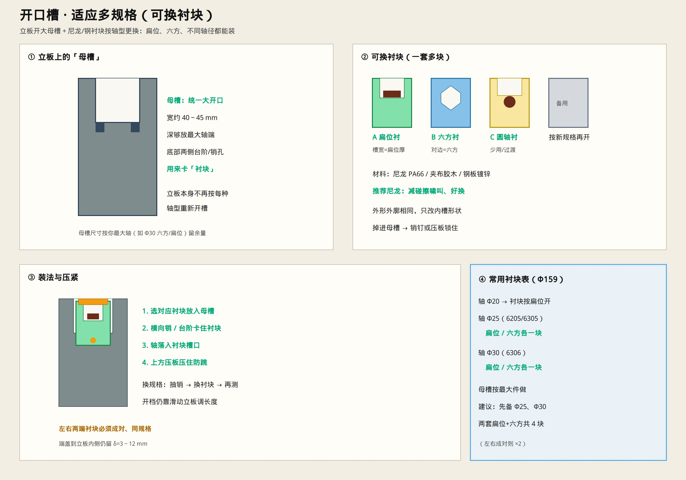

# 开口槽 · 多规格适配（可换衬块）

> 立板开统一 **母槽**，用可换衬块适应不同轴径 / 扁位 / 六方。  
> 只保留示意图与说明。



---

## 一句话

**母槽固定大开口 + 尼龙衬块按规格更换**；换辊规格只换衬块，不改焊接立板。

---

## 怎么设计

### 1）母槽（焊在立板上）

- 统一大 U 口，宽约 **40～45 mm**（按你最大轴端留余量）  
- 底部做台阶或销孔，用来卡住衬块  
- 左右立板母槽相同  

### 2）衬块（一套多块，外廓相同）

| 衬块 | 内槽形状 | 典型用途 |
|------|----------|----------|
| A | 扁位槽 | 扁位轴端 |
| B | 六方孔/槽 | 六方轴端 |
| C | 圆托（少用） | 过渡/圆轴 |
| 备用 | 按新规格再开 | 以后扩展 |

材料：**尼龙 PA66**（推荐，减啸叫）或夹布胶木 / 钢板。  
外廓一律能落入母槽；只改内孔形状。

### 3）装法

```text
选衬块 → 放入母槽 → 销钉/台阶锁住
→ 轴落入衬块槽 → 上方压板防跳
```

换规格：抽销 → 换衬块 → 开档仍用滑动立板调长度。

---

## 常用备件（Φ159 实验室）

先备齐（**左右成对**）：

- Φ25：扁位衬 ×2、六方衬 ×2  
- Φ30：扁位衬 ×2、六方衬 ×2  

母槽按 **Φ30 最大件** 做。

---

## 仍要守住的

- 轴固定、筒转动（驱动仍在筒外圆）  
- 端盖与立板内侧 **δ = 3～12 mm**  
- 对比试验：同衬块规格、同开档、同转速，只换辊  

工装总图：[`IDLER_TEST_FIXTURE.md`](./IDLER_TEST_FIXTURE.md)
