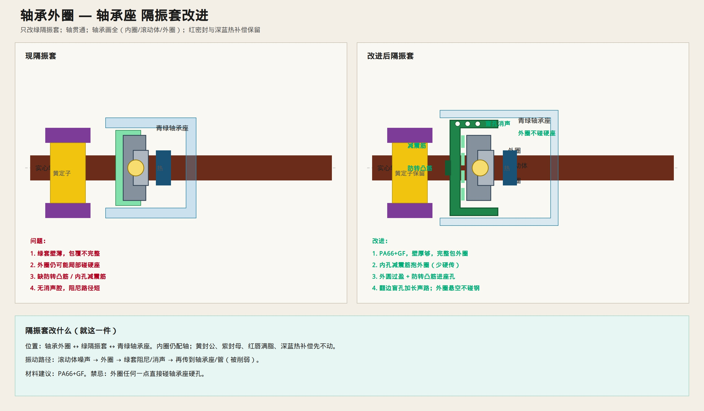

# 轴承外圈 — 轴承座 隔振套改进

> 只改**外圈与轴承座之间**的绿色隔振套。  
> 轴贯通；轴承画全。黄封公 / 红唇满脂 / 深蓝热补偿先不动。



---

## 现问题

- 绿套偏薄、包覆不完整  
- 外圈仍可能局部碰到青绿轴承座硬孔  
- 缺防转、缺内孔减震筋  
- 少消声结构，阻尼路径短  

---

## 怎么改

```text
轴承外圈 → 内孔减震筋（轻抱）→ 绿隔振套本体（PA66+GF）
         → 外圆过盈 + 防转凸筋 → 青绿轴承座
翻边开盲孔：加长声路
外圈任何一点不得碰硬座
```

| 项 | 做法 |
|----|------|
| 包覆 | 外圈周向完整隔开硬座 |
| 内孔 | 均布减震筋抱外圈 |
| 外圆 | 过盈进座孔 + 防转凸筋 |
| 消声 | 翻边盲孔 / 消声腔 |
| 材料 | PA66+GF |
| 其它件 | 黄定子、红唇+脂、深蓝热补偿、轴配合保留 |

---

## 振动怎么走

```text
滚动体 → 外圈 → ★绿隔振套★ → 轴承座 → 管
              （阻尼削弱）
```

这是主静音件。内圈—轴隔离仍是次要选项，见 [`INNER_RACE_SHAFT.md`](./INNER_RACE_SHAFT.md)。  
总认件图：[`COMPLETE_BEARING.md`](./COMPLETE_BEARING.md)。  
**更静音减震座：** [`DAMPER_SEAT_QUIETER.md`](./DAMPER_SEAT_QUIETER.md)
