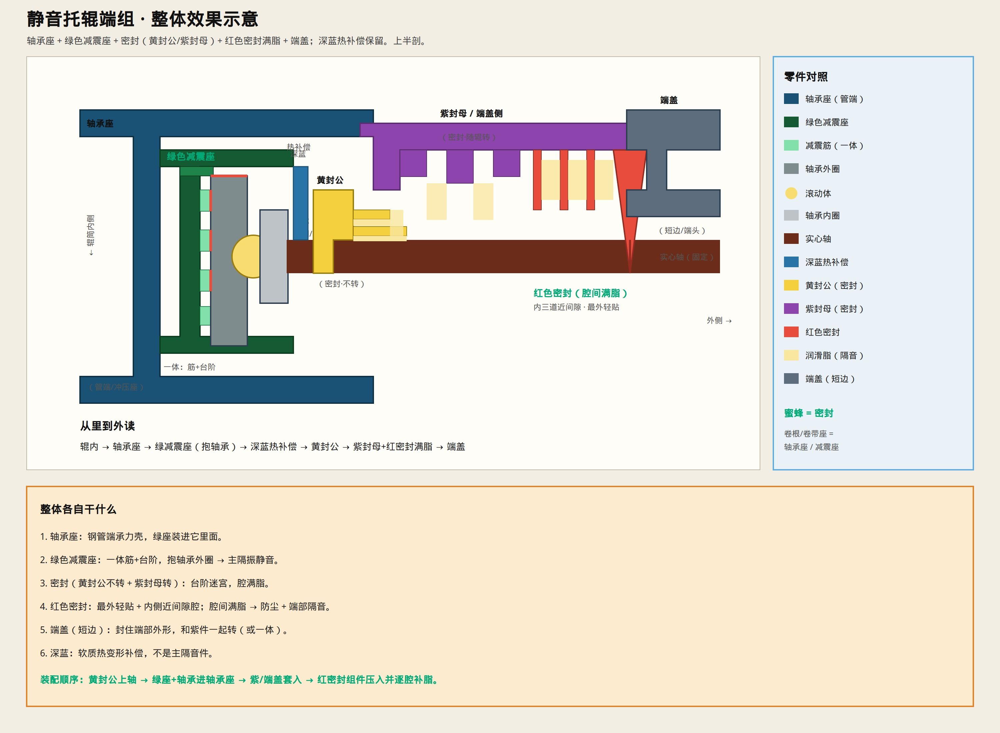

# 静音托辊端组 · 整体效果

> 卷根座 = **轴承座**；绿色卷带座 = **绿色减震座**；蜜蜂 = **密封**；短边 = **端盖**。  
> 只保留示意图与说明。



---

## 从里到外

```text
辊内 → 轴承座 → 绿色减震座（抱轴承）→ 深蓝热补偿
     → 黄封公（密封·不转）→ 紫封母（密封·转）+ 红色密封满脂
     → 端盖（短边）
```

| 件 | 干什么 |
|----|--------|
| **轴承座** | 管端承力壳，绿座装进去 |
| **绿色减震座** | 一体筋+台阶，抱外圈 → 主隔振静音 |
| **密封**（黄封公+紫封母） | 台阶迷宫，腔满脂 |
| **红色密封** | 最外轻贴 + 内侧近间隙腔；腔间满脂 → 防尘+端部隔音 |
| **端盖** | 封端部外形 |
| **深蓝** | 热变形补偿（不是主隔音） |

装配：黄封公上轴 → 绿座+轴承进轴承座 → 紫/端盖套入 → 红密封压入并逐腔补脂。

相关细部：[`INTEGRAL_SEAT_AXON.md`](./INTEGRAL_SEAT_AXON.md) · [`RED_SEAL_IMPROVE.md`](./RED_SEAL_IMPROVE.md) · [`COLOR_LEGEND.md`](./COLOR_LEGEND.md)

轴向长度（Φ159，绿座与轴承齐平）：[`PHI159_AXIAL_LENGTHS.md`](./PHI159_AXIAL_LENGTHS.md)
