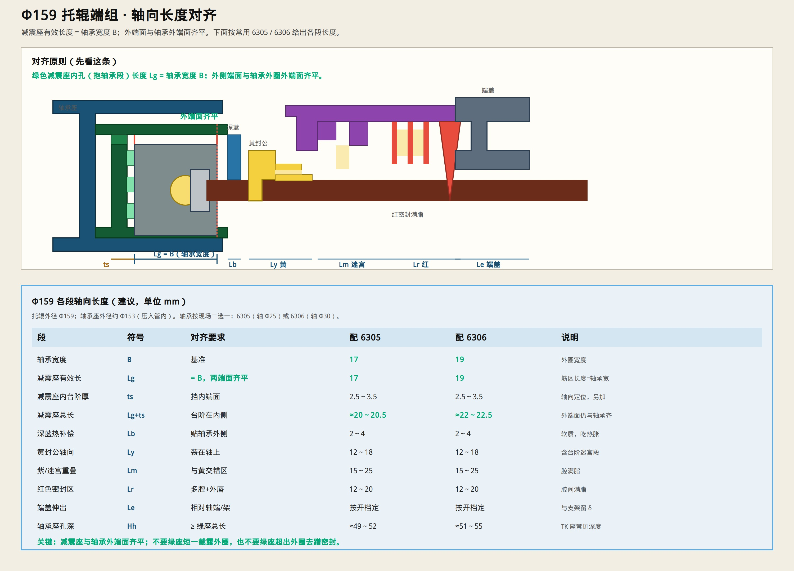

# Φ159 托辊 · 各端轴向长度

> 你指出的问题对：**减震座长度要和轴承端面齐平**，不能短一截、也不能乱伸出。  
> 托辊规格：**Φ159**。  
> 只保留示意图与说明。



---

## 对齐原则（先定这条）

**绿色减震座内孔有效长度 Lg = 轴承宽度 B。**  
**减震座外端面与轴承外圈外端面齐平。**

- 内侧：绿座内台阶挡住轴承内端面（轴向定位）  
- 外侧：绿座不要短于轴承（露外圈），也不要超出外圈去蹭密封件  

```text
轴承内端面 ──顶──→ 绿座内台阶
轴承外端面 ──齐──→ 绿座外端面
```

---

## Φ159 各段长度（mm）

轴承按现场二选一（先定轴承，再定绿座）：

| 段 | 符号 | 对齐要求 | 配 **6305**（轴Φ25） | 配 **6306**（轴Φ30） |
|----|------|----------|---------------------|---------------------|
| 轴承宽度 | **B** | 基准 | **17** | **19** |
| 减震座有效长 | **Lg** | **= B，两端面齐平** | **17** | **19** |
| 减震座内台阶厚 | **ts** | 挡内端面 | 2.5～3.5 | 2.5～3.5 |
| 减震座总长 | **Lg+ts** | 台阶在内侧 | ≈20～20.5 | ≈22～22.5 |
| 深蓝热补偿 | **Lb** | 贴轴承外侧 | 2～4 | 2～4 |
| 黄封公轴向 | **Ly** | 装在轴上 | 12～18 | 12～18 |
| 紫/迷宫重叠 | **Lm** | 与黄交错、满脂 | 15～25 | 15～25 |
| 红色密封区 | **Lr** | 多腔+外唇、满脂 | 12～20 | 12～20 |
| 端盖伸出 | **Le** | 相对轴端/支架 | 按开档，留间隙 δ | 同左 |
| 轴承座孔深 | **Hh** | ≥ 绿座总长 | ≈49～52（TK常见） | ≈51～55 |

径向配套（供对照）：

| | 6305 | 6306 |
|--|------|------|
| 轴承 | 25×62×17 | 30×72×19 |
| 管外径 | Φ159 | Φ159 |
| 轴承座外径（压入管） | ≈Φ153 | ≈Φ153 |

---

## 一句话

Φ159 上：**减震座抱轴承段长度跟轴承宽度走，外端面跟轴承外端面齐**；密封、红唇、端盖的长度叠在轴承外侧，另算。

若你现场轴承不是 6305/6306，报型号我按 B 改一版数字。

筋的周向角度：[`RIB_ANGLE_DEGREES.md`](./RIB_ANGLE_DEGREES.md)
