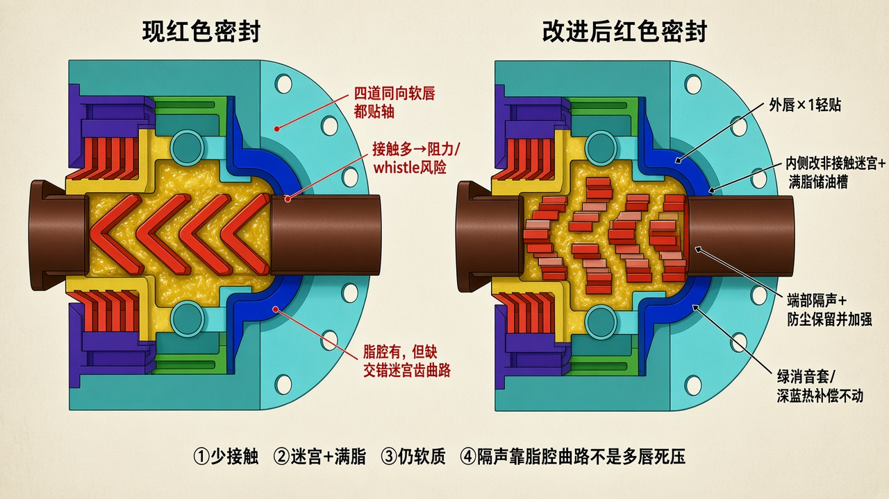

# 红色密封改进

> 依据你最新 CAD：四道同向红色 V 形软唇，装在黄件里，齿间有脂。  
> 原图：[`figures/ref-red-seal-current.jpg`](./figures/ref-red-seal-current.jpg)  
> 总原理：[`SILENT_SEAT_PRINCIPLE.md`](./SILENT_SEAT_PRINCIPLE.md)  
> 只保留示意图与说明。



---

## 现结构（红件）

- **四道**同向 V 形软唇，都朝外侧张开  
- 唇口都贴轴（或贴得很近）  
- 唇间有润滑脂  
- 黄件当保持架；紫件在外  

作用仍成立：防尘 + 脂腔削弱轴承声从端部传出。  
短板：四道都接触 → 阻力叠、啸叫风险高；缺少**交错非接触迷宫齿**，曲路主要靠多唇挤出来，对静音不划算。

---

## 改进怎么改

**外侧只留 1 道软唇轻贴；内侧改成非接触迷宫 + 满脂储油槽。**

```text
外侧 → 软唇×1（轻贴，不刮伤轴）
     → 迷宫 4～5 级（黄件转子齿 ╳ 红/定子齿，间隙约 0.3～0.6 mm）
     → 空隙满脂（储油槽：防尘 + 隔断端部传声）
     → 轴承（绿消音套、深蓝热补偿不动）
```

| 改什么 | 做法 |
|--------|------|
| 四道红唇 | 最外 **保留 1 道**；内侧 3 道取消或改成迷宫齿 |
| 黄件 | 加与红侧交错的迷宫齿（随座转＝转子） |
| 脂 | 迷宫/储油槽 **充满**（端部隔声靠它） |
| 材质 | 仍用软质；外唇轻贴，禁止多唇重压 |
| 绿 / 深蓝 | 不改 |

---

## 为什么这样更静、更稳

- 接触从 4 道降到 1 道 → 少摩擦啸叫  
- 迷宫曲路 + 满脂 → 防尘更好，端部声路仍按静音座原理保留  
- 软质不刮轴的优点留下  

绿消音套（结构隔振）、深蓝软件（热变形）继续按原分工，只动红色密封区。
