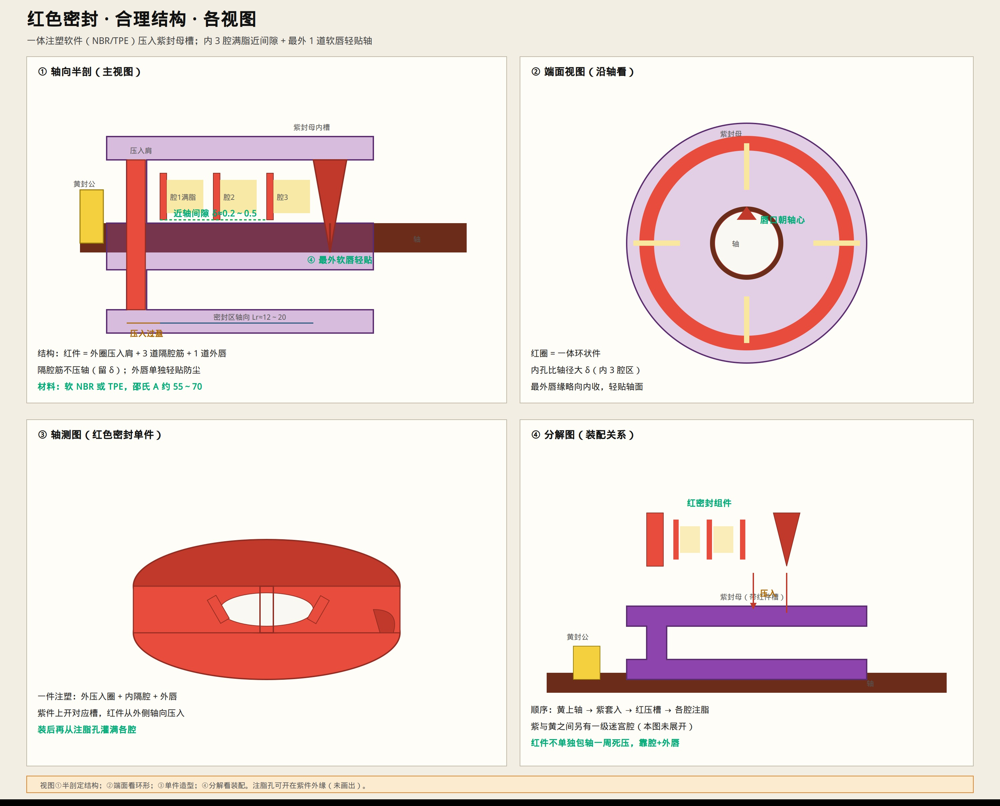
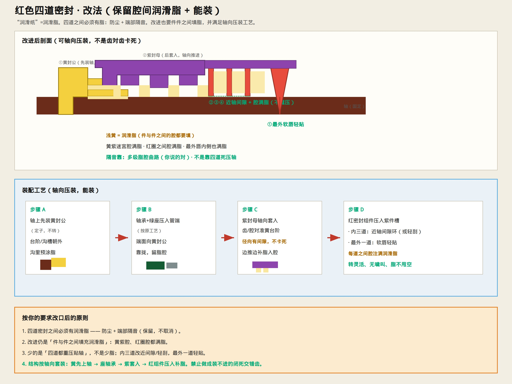
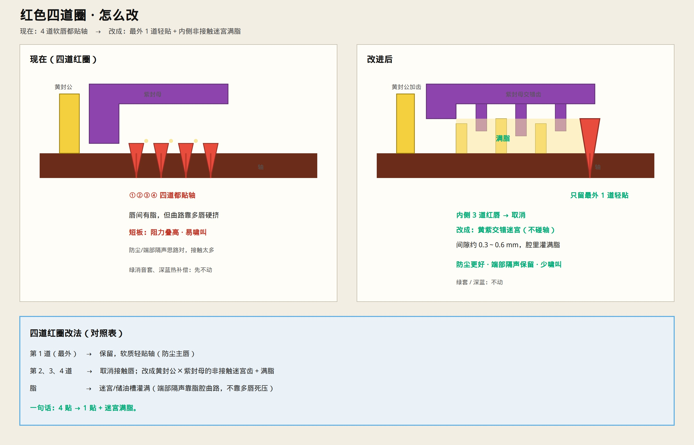

# 红色四道密封 · 改进（满脂 + 能装）

> “润滑纸”按 **润滑脂** 理解；“四道蜜蜂”按 **四道密封** 理解。  
> 你的要求：**密封之间要有脂（隔音+防尘）**；改进后仍要件件填脂；**满足轴向装配工艺**。  
> 只保留示意图与说明。





结构详图：[`RED_SEAL_STRUCTURE.md`](./RED_SEAL_STRUCTURE.md)



---

## 先认你的点（改口）

1. **四道密封之间必须有润滑脂** —— 对。  
2. 脂不只润滑，还 **端部隔音** —— 对（多级脂腔曲路）。  
3. 改进后仍要 **件与件之间填脂** —— 对。  
4. 上一版“齿对齿咬死”的迷宫示意 **不好装** —— 你说得对，下面按能装改。

---

## 改进改什么、不改什么

| | 做法 |
|--|------|
| **保留** | 多级腔 + **腔间满润滑脂**（防尘 + 隔音） |
| **改** | 四道都重压贴轴 → 最外 1 道轻贴；内 3 道改为近轴间隙（或极轻刮）+ 满脂腔 |
| **改** | 黄封公 / 紫封母做成 **可轴向套入** 的台阶迷宫（径向留间隙），禁止闭死咬合齿 |
| **不动** | 绿消音套、深蓝热补偿 |

```text
最外 → 软唇×1 轻贴轴
     → 红密封腔×3（近间隙）—— 每腔满脂
     → 黄紫台阶迷宫腔 —— 满脂
     → 轴承 / 绿座
```

**少的是贴轴压力，不是脂。隔音仍靠脂腔。**

---

## 装配工艺（轴向压装）

| 步 | 做什么 | 脂 |
|----|--------|-----|
| A | 轴上先装 **黄封公**（沟槽朝外） | 沟里预涂脂 |
| B | **轴承+绿座** 压入管端（原工艺） | 靠拢黄件，留脂腔 |
| C | **紫封母** 轴向套入黄台阶（径向有间隙，不卡死） | 边推边补脂入腔 |
| D | **红密封组件** 压入紫件槽：内三道近间隙环 + 最外软唇 | **每道之间腔注满脂** |

验收：手转灵活、无啸叫、脂腔不甩空、外尘进不去。

---

## 一句话

四道密封之间继续满脂隔音；改进只把内侧三道从“死压轴”改成“近间隙满脂腔”，并按 **黄→轴承座→紫→红** 轴向套装，保证装得上。
