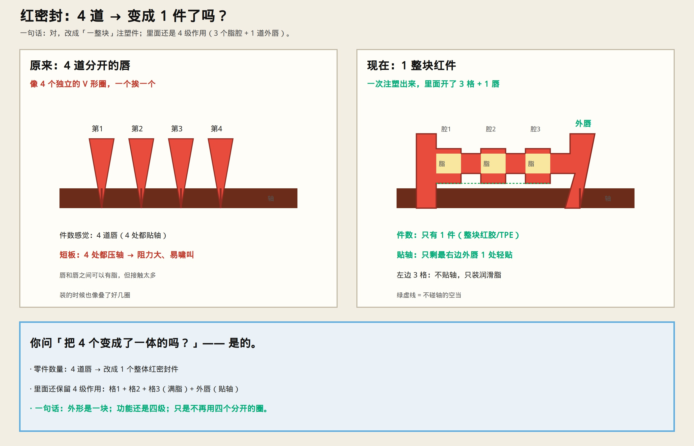

# 红密封：4 道有没有变成一体？

> 用最直白的话说清楚。



---

## 答：是的，变成 1 件了

| | 原来 | 现在 |
|--|------|------|
| **零件** | 4 道分开的红唇（像 4 个圈） | **1 整块**红密封（一次注塑） |
| **贴轴** | 4 处都贴 | **只剩最外 1 道唇**轻贴 |
| **里面** | 唇与唇之间有脂 | **3 个格子灌满脂**（不贴轴） |
| **级数** | 4 级接触 | 仍是 **4 级作用**（3 脂腔 + 1 外唇） |

```text
原来：  唇①  唇②  唇③  唇④     ← 四个分开的
现在：  [块——————整块红件——————]  ← 只有一个
         格1  格2  格3  外唇
```

**外形是一块；功能还是四级；不再用四个分开的圈。**
