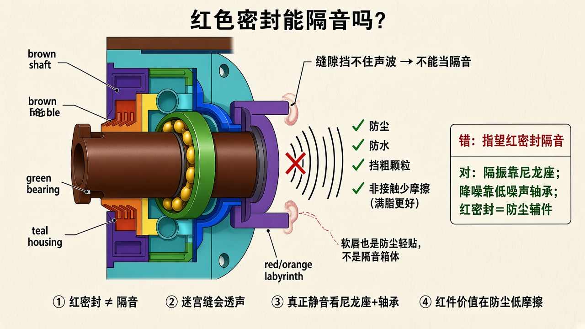
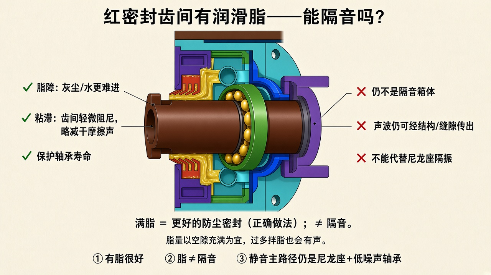

# 红色密封能隔音吗？

> 依据你 CAD 里橙/红色多齿迷宫密封。  
> 只保留示意图与说明。





---

## 结论

**不能当隔音。**  
齿间有润滑脂是对的，而且应该满脂——但脂解决的是**防尘/防水 + 减少干摩擦**，不是把声音封死。

---

## 有脂时，脂在干什么

| 脂能做的 | 脂做不到的 |
|----------|------------|
| 填满齿缝 → 灰尘、水更难进（脂障） | **隔音 / 隔声波** |
| 齿间一点粘滞阻尼，减轻干摩擦声 | 切断轴承→管体硬传振 |
| 保护轴承、维持密封寿命 | 代替尼龙降噪座 |

```text
满脂迷宫 = 更好的密封（推荐）
满脂迷宫 ≠ 隔音箱
静音主路径：尼龙座隔振 + 低噪声轴承
```

脂不宜乱加到把搅油声弄大：空隙**充满**即可，不是越厚越好。

---

## 和静音的关系（别混）

- **红迷宫 + 脂**：密封路径 → 防尘、少干摩擦  
- **尼龙座**：振动路径 → 主静音  
- **绿轴承**：振源路径 → Z2/Z3、C3、正确脂  

所以：你说「红色密封之间有润滑脂」——**做法正确，请保留**；只是不要指望靠它隔音。
