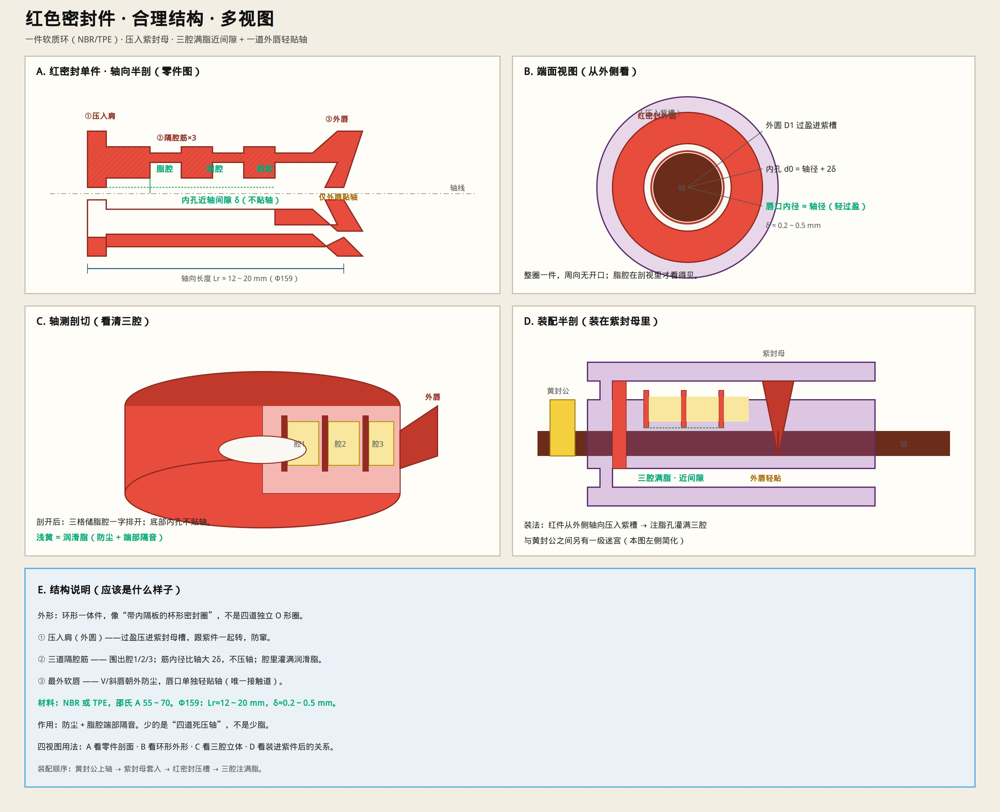

# 红色密封 · 应该长什么样（多视图）

> 合理结构：**一件**软质环形密封（不是四道独立圈），压入紫封母槽。  
> **三腔满脂近间隙 + 一道外唇轻贴轴。**  
> 只保留示意图与说明。



上一版四视图：[`figures/47-red-seal-multiview.jpg`](./figures/47-red-seal-multiview.jpg)

---

## 五张图各看什么

| 视图 | 内容 |
|------|------|
| **A 零件半剖** | 红密封单件剖面：压入肩、三隔腔、外唇 |
| **B 端面** | 环形外形；外圆压紫槽，内孔留 δ，唇口轻贴 |
| **C 轴测剖切** | 立体看清腔1/2/3 储脂 |
| **D 装配半剖** | 装进紫封母后，与轴、黄封公的关系 |
| **E 说明** | 尺寸与材料要点 |

---

## 结构就是这样

```text
红密封（NBR/TPE 一体注塑）
├─ ① 压入肩 —— 外圆过盈进紫封母槽（随辊转）
├─ ② 隔腔筋 ×3 —— 围出 3 个脂腔；内径 = 轴径 + 2δ（不压轴）
└─ ③ 最外软唇 —— 唯一贴轴，轻贴防尘
```

| 参数 | 建议（Φ159） |
|------|----------------|
| 轴向长 Lr | 12～20 mm |
| 近轴间隙 δ | 0.2～0.5 mm |
| 材料 | NBR / TPE，邵氏 A 55～70 |
| 脂 | 三腔 **灌满**（防尘 + 端部隔音） |

**不是**四道都死压轴的 V 唇叠罗汉；**是**杯形环 + 内隔板储脂 + 一道外唇。

装配：黄封公上轴 → 紫封母套入 → 红件轴向压槽 → 注脂孔灌满三腔。

改进原则：[`RED_SEAL_IMPROVE.md`](./RED_SEAL_IMPROVE.md)
