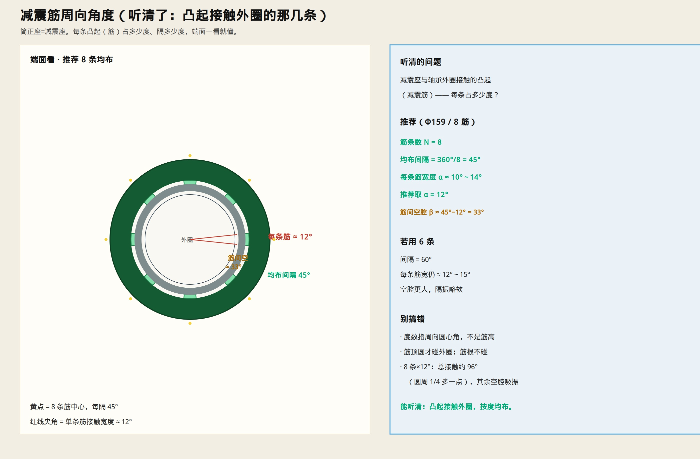

# 减震筋 · 每条多少度

> 听清了：减震座与轴承外圈接触的**凸起**（减震筋），问的是周向占多少度。  
> 只保留示意图与说明。



---

## 推荐（Φ159）

| 项目 | 数值 |
|------|------|
| 筋条数 **N** | **8** |
| 均布间隔 | **360°/8 = 45°** |
| 每条筋宽度 **α** | **10°～14°**（推荐 **12°**） |
| 筋间空腔 **β** | **≈ 33°**（45°−12°） |

```text
一周 8 条凸起
每条接触外圈 ≈ 12°
每隔 45° 一条
筋与筋之间 ≈ 33° 空腔（不碰外圈）
```

若用 **6 条**：间隔 **60°**，每条仍约 12°～15°。

---

## 别混

- 度数 = **周向圆心角**，不是筋的径向高度  
- 只有**筋顶**碰外圈；筋根/座壁光面不碰  
- 8×12° ≈ 总接触 96°（约 1/4 圈），其余空腔吸振  

轴向长度仍按：[`PHI159_AXIAL_LENGTHS.md`](./PHI159_AXIAL_LENGTHS.md)（Lg = B，端面齐平）。
