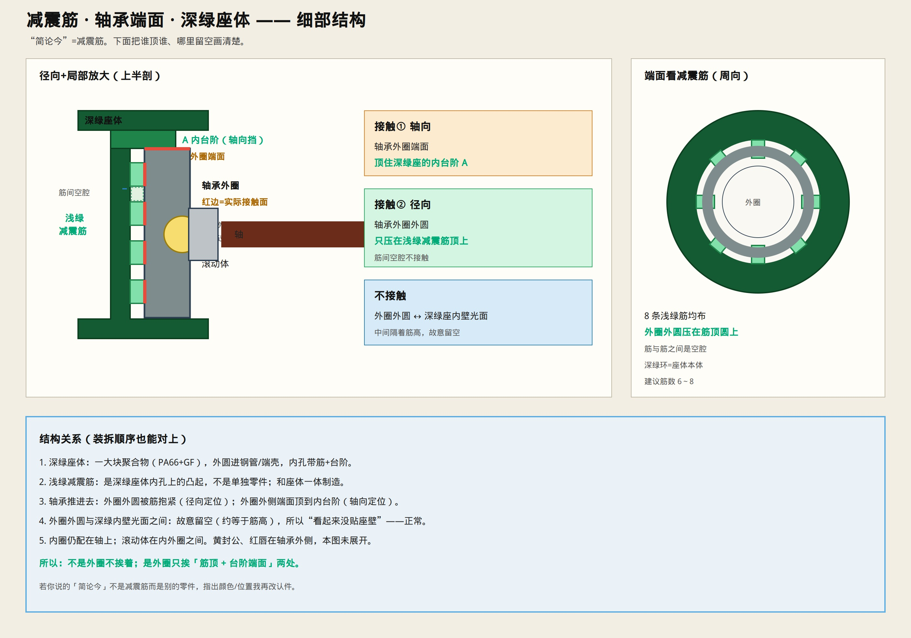

# 减震筋 · 轴承端面 · 深绿座体（细部）

> “简论今”按 **减震筋** 理解。若指别的件，再说一下颜色位置。  
> 只保留示意图与说明。



---

## 三样东西各是什么

| 名称 | 颜色 | 是什么 |
|------|------|--------|
| **深绿座体** | 深绿 | 聚合物轴承座本体（PA66+GF），一大块 |
| **减震筋** | 浅绿 | 座体内孔上的凸起，**和座体一体制造**，不是另装一件 |
| **轴承外圈** | 灰 | 轴承最外圈；有外圆面、两侧端面 |

---

## 谁顶谁（两处接触）

### 接触① 轴向 —— 轴承端面 × 座体台阶

- 轴承外圈的**外侧端面**  
- 顶住深绿座体的 **内台阶**  
- 作用：轴向定位，轴承不往里窜  

### 接触② 径向 —— 轴承外圆 × 减震筋顶

- 轴承外圈的**外圆**  
- 只压在一圈 **浅绿减震筋的筋顶**上（建议 6～8 条）  
- 作用：径向定心 + 隔振  

### 故意不接触

- 轴承外圆 **不贴满** 深绿座体内壁光面  
- 筋和筋之间是空腔  
- 所以图画上“外圈和深绿壁之间有缝”——是对的  

```text
外圈外圆 ──压──→ 浅绿筋顶（径向）
外圈端面 ──顶──→ 深绿内台阶（轴向）
外圈外圆 ──空──→ 深绿内壁光面（不贴）
```

---

## 一句话

减震筋是深绿座内孔上的凸筋；轴承靠 **筋顶抱圆、台阶挡端面** 装定位，不是悬空，也不是整圈硬贴座壁。
