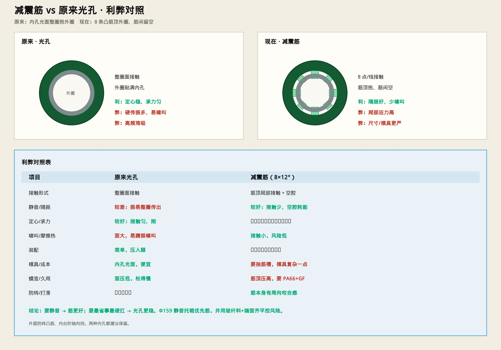

# 减震筋 vs 原来光孔 · 利弊

> 原来：减震座内孔**光面**整圈抱轴承外圈。  
> 现在：内孔 **8 条凸筋**顶外圈，筋间留空。  
> 只保留示意图与说明。

---

## 对照表

| 项目 | 原来光孔 | 减震筋（8×约12°） |
|------|----------|-------------------|
| 接触 | 整圈面接触 | 筋顶局部接触 + 空腔 |
| **静音/隔振** | 较差：振易整圈传出 | **较好**：接触少、空腔耗能 |
| **定心/承力** | **较好**：接触匀、刚 | 中等：靠筋过盈，要控尺寸 |
| 啸叫/摩擦热 | 面大，易蹭振啸叫 | 接触小，风险低 |
| 装配 | 简单，压入顺 | 过盈略敏感，要导向 |
| 模具/成本 | 内孔光面，便宜 | 要抽筋，模具复杂一点 |
| 蠕变/久用 | 面压低，松得慢 | 筋顶压高，须 **PA66+GF** |
| 防转/打滑 | 靠整圈过盈 | 筋有周向咬合感 |

---

## 利弊一句话

**光孔**  
- 利：定心稳、承力匀、好装、模具省、蠕变慢  
- 弊：隔振差、易把轴承高频传给座/管、面接触易啸叫  

**减震筋**  
- 利：更静、少啸叫、空腔吸振、周向略抗打滑  
- 弊：局部应力高、尺寸/过盈要严、模具稍贵、久用靠材料抗蠕变  

---

## 怎么选

- **静音托辊（Φ159）**：优先减震筋 + PA66+GF，Lg=B 端面齐平。  
- **只要结实省事、噪声不敏感**：光孔也能用。  

外圆防转凸筋、内台阶轴向挡——两种内孔都建议保留。
