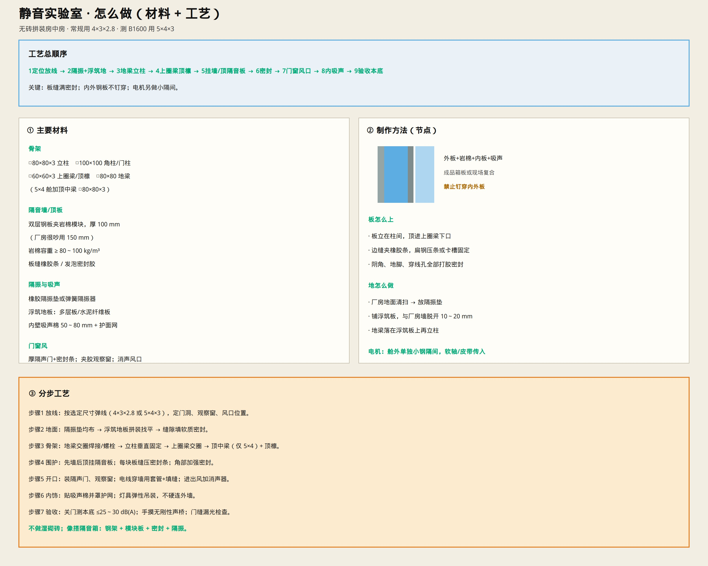

# 静音实验室 · 怎么做（材料 + 制作方法 + 工艺）

> 无砖拼装房中房，专供静音托辊对比测噪声。  
> 只保留示意图与说明。
>
> **要达标时：强制指标与升级项见 [`SILENT_LAB_STANDARD.md`](./SILENT_LAB_STANDARD.md)。**



尺寸选型：[`ACOUSTIC_TEST_ROOM.md`](./ACOUSTIC_TEST_ROOM.md)  
测试工具：[`TEST_TOOLS_ENV.md`](./TEST_TOOLS_ENV.md)

---

## 一句话

**钢骨架 + 钢板夹岩棉模块板 + 浮筑隔振地 + 缝密封 + 内吸声**；电机放舱外小隔间。

| 用途 | 内净尺寸 |
|------|----------|
| 常规 Φ159 | **4.0 × 3.0 × 2.8 m** |
| 要测 B1600 | **5.0 × 4.0 × 3.0 m** |

---

## ① 需要什么材料

### 骨架（方管）

| 部位 | 规格 |
|------|------|
| 立柱 | □80×80×3（柱距 0.9～1.2 m） |
| 角柱 / 门柱 | □100×100×3～4 |
| 地梁 | □80×80×3 或 10# 槽钢 |
| 上圈梁 / 顶檩 | □60×60×3 |
| 顶中梁（仅 5×4 舱） | □80×80×3（把 4 m 向一分为二） |
| 卡板压条 | 40×4 扁钢或成品卡槽 |

### 隔音围护

| 材料 | 规格 / 要求 |
|------|-------------|
| 墙/顶隔音板 | 双层钢板夹岩棉，**厚 100 mm**（厂房很吵用 150） |
| 岩棉 | 容重 **≥ 80～100 kg/m³** |
| 板缝 | 橡胶密封条 + 密封胶 |
| 可选项 | 成品隔音箱板（同厚度） |

### 隔振与吸声

| 材料 | 用途 |
|------|------|
| 橡胶隔振垫 / 弹簧隔振器 | 切断厂房地振 |
| 浮筑地板 | 多层板或水泥纤维板，与厂房脱开 |
| 吸声棉 50～80 mm + 护面网 | 贴内壁、顶 |

### 门窗风电

| 材料 | 用途 |
|------|------|
| 厚隔声门 + 气密条 | 进出（有预算再上双道声闸） |
| 双层夹胶观察窗 | 舱外操作看 |
| 消声器 / 消声风口 | 进出风 |
| 过墙套管 + 填缝料 | 电缆穿舱 |

### 驱动小隔间（另做）

同样钢板岩棉小舱（约 1.2×1.0×1.5 m 量级），放电机/减速；皮带或软轴传入主舱。

---

## ② 制作方法（怎么做成）

### 墙板构造（由外→内）

```text
外钢板 1.5～2 mm
  → 岩棉 100～150 mm
  → 内钢板 1.2～1.5 mm
  → （装完后再贴）吸声棉 50～80 mm
```

- 用成品箱板，或按上序现场复合  
- **禁止一颗钉打穿内外钢板**（会漏声、传振）  
- 板立柱间，顶进上圈梁；边缝夹橡胶条再压条  

### 地面做法

细部：[`LAB_FLOOR.md`](./LAB_FLOOR.md)


```text
厂房地面清扫
  → 均布隔振垫
  → 铺浮筑地板（与厂房墙留 10～20 mm 缝，软填）
  → 地梁落在浮筑板上
```

### 骨架做法

- 地梁四边交圈（焊或高强螺栓）  
- 立柱垂直、与地梁固接  
- 上圈梁交圈骑在柱顶  
- 5×4 舱加顶中梁，再布顶檩（间距 0.8～1.0 m）  

框架示意：[`figures/54-full-steel-frame.jpg`](./figures/54-full-steel-frame.jpg)

---

## ③ 工艺步骤（按顺序干）

| 步 | 做什么 | 要点 |
|----|--------|------|
| 1 | **放线** | 弹内净轮廓；定门、窗、风口、电机传入位置 |
| 2 | **隔振+浮筑地** | 垫均匀；地板找平；周边脱开厂房 |
| 3 | **地梁→立柱→上圈梁** | 交圈、垂直；门洞柱加粗 |
| 4 | **顶中梁+顶檩** | 5×4 必做中梁；4×3 可简化 |
| 5 | **挂墙板→挂顶板** | 先墙后顶；每缝密封条；角部加胶 |
| 6 | **门窗、穿线、风口** | 门密封到位；穿墙必套管填实；风口加消声 |
| 7 | **内吸声** | 棉贴满墙顶，罩护网；灯弹性吊 |
| 8 | **电机小隔间** | 舱外拼装；软连接传动进主舱 |
| 9 | **验收** | 关门本底 **≤25～30 dB(A)**；查漏光/漏缝；无刚性声桥 |

---

## ④ 验收合格再拿来测辊

- [ ] 本底达标  
- [ ] 门缝、板缝、穿墙孔不漏光漏风感  
- [ ] 敲内外板：不是“铁皮鼓”直通声  
- [ ] 电机开在隔间内时，主舱噪声不明显被电机带走  
- [ ] 测点 1 m 位置可固定重复  

然后按 [`TEST_TOOLS_ENV.md`](./TEST_TOOLS_ENV.md) 做对比测序。

---

## ⑤ 省钱工艺提醒

- 常规实验优先 **4×3×2.8 + 100 mm 板**  
- 门先单道厚隔声门；尖劈改吸声棉  
- 不砌砖、不浇筑复杂基础  
- 只做相对对比，不按国家级消声室标准堆料

门的做法：[`ACOUSTIC_DOOR.md`](./ACOUSTIC_DOOR.md)
