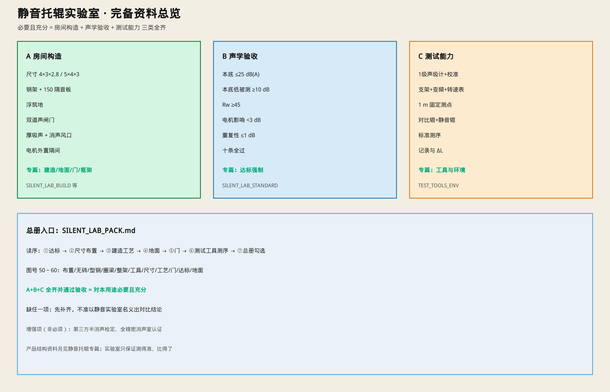

# 静音托辊实验室 · 完备资料总册

> **必要且充分**：按本总册配齐并验收通过，即可建成可用的企业半消声静音托辊实验室，并开展对比测噪声。  
> 只保留示意图与说明；细部见各专篇链接。

---

## 0. 一句话

**半消声拼装舱（钢板岩棉）+ 浮筑地 + 双道声闸 + 电机外置 + 1 级声级计台架**；本底达标后，同速同点对比普通辊与静音辊。

| 决策 | 取值 |
|------|------|
| 常规 Φ159 | 内净 **4.0 × 3.0 × 2.8 m** |
| 要测 B1600 | 内净 **5.0 × 4.0 × 3.0 m** |
| 标准等级 | 企业半消声达标版（非国家级精密消声室全套） |

---

## 1. 必要且充分条件（总表）

下面 **全部具备** 才算“充分”；缺任一项则 **不必要/不充分**，不得称实验室已达标开测。

### 1.1 房间与构造（必要）

| # | 条件 | 专篇 |
|---|------|------|
| A1 | 选定尺寸（4×3×2.8 或 5×4×3） | [`ACOUSTIC_TEST_ROOM.md`](./ACOUSTIC_TEST_ROOM.md) |
| A2 | 无砖：钢骨架 + 钢板夹岩棉围护 | [`SILENT_LAB_BUILD.md`](./SILENT_LAB_BUILD.md) |
| A3 | 墙/顶板厚 **150 mm**（或双层100+空腔），Rw≥45 | [`SILENT_LAB_STANDARD.md`](./SILENT_LAB_STANDARD.md) |
| A4 | **浮筑隔振地面**，周边缝软填 | [`LAB_FLOOR.md`](./LAB_FLOOR.md) |
| A5 | **双道声闸门** + 密封不透光 | [`ACOUSTIC_DOOR.md`](./ACOUSTIC_DOOR.md) |
| A6 | 墙顶厚吸声；穿墙套管填实；消声风口 | [`SILENT_LAB_BUILD.md`](./SILENT_LAB_BUILD.md) |
| A7 | 电机舱外小隔间 + 软连接 | [`ACOUSTIC_TEST_ROOM.md`](./ACOUSTIC_TEST_ROOM.md) |
| A8 | 钢架：地梁/立柱/圈梁/檩（5×4 加顶中梁） | 图 52～54 |

### 1.2 声学验收（必要）

| # | 条件 | 指标 |
|---|------|------|
| B1 | 关门本底 | **≤ 25 dB(A)**（争取 ≤20） |
| B2 | 本底相对被测辊 | **低 ≥ 10 dB** |
| B3 | 电机隔间开启 | 主舱增量 **&lt; 3 dB(A)** |
| B4 | 重复性 | 同点 3 次偏差 **≤ 1 dB(A)** |
| B5 | 十条验收全过 | [`SILENT_LAB_STANDARD.md`](./SILENT_LAB_STANDARD.md) |

### 1.3 测试能力（必要）

| # | 条件 | 专篇 |
|---|------|------|
| C1 | 1 级声级计 + 声校准器 + 三脚架/1 m 定位 | [`TEST_TOOLS_ENV.md`](./TEST_TOOLS_ENV.md) |
| C2 | 试验工装 + 变频调速 + 转速表 | [`IDLER_TEST_FIXTURE.md`](./IDLER_TEST_FIXTURE.md) |
| C3 | 同规格普通对比辊 + 静音辊 | 同上 |
| C4 | 固定测序：本底→普通辊→静音辊→算 ΔL | 同上 |

**充分性说明：** A1～A8 + B1～B5 + C1～C4 齐备并通过验收 = 对本用途（Φ159 静音托辊对比测噪声）**必要且充分**。  
超出项（第三方精密消声认证、全尖劈消声室）为增强项，非本总册充分条件。

---

## 2. 资料目录（按使用顺序读）

| 顺序 | 文档 | 内容 |
|------|------|------|
| ① | [`SILENT_LAB_STANDARD.md`](./SILENT_LAB_STANDARD.md) | **先读**：达标硬指标与验收十条 |
| ② | [`ACOUSTIC_TEST_ROOM.md`](./ACOUSTIC_TEST_ROOM.md) | 尺寸选型、布置、省钱 vs 达标 |
| ③ | [`SILENT_LAB_BUILD.md`](./SILENT_LAB_BUILD.md) | 材料 + 制作方法 + 分步工艺 |
| ④ | [`LAB_FLOOR.md`](./LAB_FLOOR.md) | 地面浮筑隔振 |
| ⑤ | [`ACOUSTIC_DOOR.md`](./ACOUSTIC_DOOR.md) | 门扇；达标必须双道声闸 |
| ⑥ | [`IDLER_TEST_FIXTURE.md`](./IDLER_TEST_FIXTURE.md) | **托辊试验工装设计** |
| ⑥b | [`MULTI_SIZE_SLOT.md`](./MULTI_SIZE_SLOT.md) | **多规格开口槽衬块** |
| ⑦ | [`TEST_TOOLS_ENV.md`](./TEST_TOOLS_ENV.md) | 仪器、测序 |
| ⑧ | 本总册 `SILENT_LAB_PACK.md` | 总清单与勾选 |

产品侧（测什么辊）可对照：[`DESIGN.md`](./DESIGN.md) §7、[`OVERALL_END_ASSEMBLY.md`](./OVERALL_END_ASSEMBLY.md)。

---

## 3. 示意图索引（实验室专用）

| 图 | 文件 | 看什么 |
|----|------|--------|
| 布置 | [`figures/50-acoustic-test-room.jpg`](./figures/50-acoustic-test-room.jpg) | 平面测点 |
| 无砖做法 | [`figures/51-no-brick-acoustic-room.jpg`](./figures/51-no-brick-acoustic-room.jpg) | 拼装舱 |
| 型钢卡板 | [`figures/52-steel-frame-for-panels.jpg`](./figures/52-steel-frame-for-panels.jpg) | 柱梁卡板 |
| 圈梁 | [`figures/53-ring-beam-schematic.jpg`](./figures/53-ring-beam-schematic.jpg) | 上横梁 |
| 整架 | [`figures/54-full-steel-frame.jpg`](./figures/54-full-steel-frame.jpg) | 4×5 框架 |
| 工具环境 | [`figures/55-test-tools-environment.jpg`](./figures/55-test-tools-environment.jpg) | 测序工具 |
| 尺寸分档 | [`figures/56-cost-size-acoustic-room.jpg`](./figures/56-cost-size-acoustic-room.jpg) | 4×3 vs 5×4 |
| 工艺 | [`figures/57-lab-build-process.jpg`](./figures/57-lab-build-process.jpg) | 材料工艺 |
| 门 | [`figures/58-acoustic-door.jpg`](./figures/58-acoustic-door.jpg) | 门扇密封 |
| 达标 | [`figures/59-lab-standard-compliance.jpg`](./figures/59-lab-standard-compliance.jpg) | 强制指标 |
| 地面 | [`figures/60-lab-floor.jpg`](./figures/60-lab-floor.jpg) | 浮筑地 |
| 工装 | [`figures/62-idler-test-fixture.jpg`](./figures/62-idler-test-fixture.jpg) | 托辊试验工装 |
| 双架立体 | [`figures/68-latest-3d-dual-frame.jpg`](./figures/68-latest-3d-dual-frame.jpg) | 型材+板搭接立体图 |

---

## 4. 材料总清单（采购用）

### 4.1 骨架

- □80×80×3 立柱、地梁（适量）  
- □100×100×3～4 角柱/门柱  
- □60×60×3 上圈梁、顶檩  
- □80×80×3 顶中梁（仅 5×4 舱）  
- 40×4 扁钢压条或成品卡槽；密封橡胶条  

### 4.2 围护与吸声

- 钢板夹岩棉板：**150 mm**；或 **70 mm ×2**（墙顶按双层展开面积）  
- 空腔岩棉（双 70 方案，容重 ≥80～100 kg/m³）  
- 板缝密封胶、橡胶条；发泡胶仅堵缝  
- 厚吸声层/尖劈（墙顶）  
- 护面网  

### 4.3 地面

- 橡胶隔振垫或弹簧隔振器（间距 400～600）  
- 浮筑地板 18～25 mm  
- 周边软填材料  

### 4.4 门窗风电

- 隔声门 ×2 + 声闸前室骨架/板  
- 双层夹胶观察窗  
- 进出风消声器  
- 过墙套管、填缝料  
- 舱内灯具（弹性吊装）  

### 4.5 驱动与测试

- 电机小隔间（钢板岩棉）  
- 变频电机、减速、皮带/软轴  
- 托辊试验支架、转速表  
- 1 级声级计、声校准器、三脚架/1 m 杆  
- （建议）频谱、百分表、阻力仪、温湿度计  

细部规格以各专篇为准。

---

## 5. 实施勾选（从零到开测）

### 阶段 I · 决策

- [ ] 选定尺寸：□ 4×3×2.8　□ 5×4×3（B1600）  
- [ ] 确认按 **达标版**（非仅省钱单门/100 板）  

### 阶段 II · 建造

- [ ] 放线  
- [ ] 浮筑地完成（[`LAB_FLOOR.md`](./LAB_FLOOR.md)）  
- [ ] 钢架完成（地梁→柱→圈梁→檩）  
- [ ] 150 板墙顶挂完并全缝密封  
- [ ] 双道声闸门完成  
- [ ] 观察窗、消声风口、穿墙密封  
- [ ] 内吸声完成  
- [ ] 电机隔间 + 软连接完成  

### 阶段 III · 验收

- [ ] [`SILENT_LAB_STANDARD.md`](./SILENT_LAB_STANDARD.md) 十条全过  
- [ ] 本底记录存档（含频谱更好）  

### 阶段 IV · 开测

- [ ] 仪器校准  
- [ ] 按 [`TEST_TOOLS_ENV.md`](./TEST_TOOLS_ENV.md) 测序：本底→普通辊→静音辊→ΔL  
- [ ] 测点 1 m 固定；同速同架只换辊  

---

## 6. 充要边界（避免做错范围）

| 属于本实验室充要范围 | 不属于（另册） |
|----------------------|----------------|
| 舱体、门、地、吸声、隔振 | 托辊产品图纸改版细节 |
| 本底/隔声验收 | 国家级精密消声室全套认证（可选增强） |
| 对比测噪声仪器与测序 | 矿山现场在线监测 |
| 电机隔间 | 整条输送机台架 |

产品静音结构本身见总入口与各零件专篇；**实验室只保证“测得准、比得了”。**

---

## 7. 入口

- 实验室总册（本文）：`SILENT_LAB_PACK.md`  
- 达标：[`SILENT_LAB_STANDARD.md`](./SILENT_LAB_STANDARD.md)  
- 建造：[`SILENT_LAB_BUILD.md`](./SILENT_LAB_BUILD.md)  
- 测试：[`TEST_TOOLS_ENV.md`](./TEST_TOOLS_ENV.md)  
