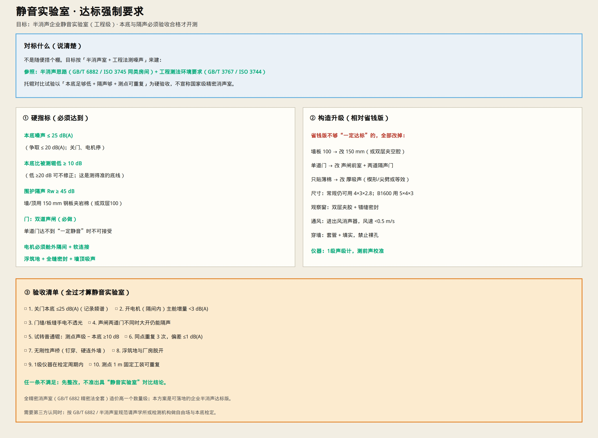

# 静音实验室 · 达标强制要求

> 你要的是：**一定要达到静音实验室标准**，不是“凑合能测”。  
> 下面按可落地的 **企业半消声静音实验室（工程级）** 执行。  
> 只保留示意图与说明。

---

## 对标什么

| 层级 | 标准 / 思路 | 本实验室怎么用 |
|------|-------------|----------------|
| 房间类型 | 半消声室（GB/T 6882、ISO 3745 同类） | 墙顶强吸声、地面反射或浮筑，按半消声建 |
| 测量方法 | 工程法环境（GB/T 3767 / ISO 3744） | 本底比信号低、测点可重复 |
| 硬规则 | 本底低于测信号 **≥10 dB** | 验收与开测的底线 |

说明：国家级 **精密消声室** 全套认证贵一个数量级。本文件是 **企业达标版**：指标写死、构造升级、验收不过不准用“静音实验室”名义出对比结论。若要第三方认证书，再请声学机构按半消声规范检定。

---

## 硬指标（必须达到）

| 指标 | 强制值 |
|------|--------|
| 关门本底（电机停） | **≤ 25 dB(A)**（争取 ≤20） |
| 本底相对被测辊 | **低 ≥ 10 dB**（低 ≥20 dB 可不修正） |
| 围护隔声 | **Rw ≥ 45 dB** |
| 门 | **双道声闸**（单道不算达标） |
| 驱动 | **电机舱外隔间 + 软连接** |
| 地面 | **浮筑隔振**，与厂房脱开 |
| 墙顶 | **强吸声**（尖劈/楔形或等效厚吸声） |
| 仪器 | **1 级声级计**，测前声校准 |

尺寸：常规 **4.0×3.0×2.8 m**；测 B1600 用 **5.0×4.0×3.0 m**。

---

## 相对“省钱版”必须升级的项

| 省钱版 | 达标版（强制改） |
|--------|------------------|
| 墙板 100 mm / 只有 70 mm | **150 mm** 单板；或 **两道 70 mm + 空腔 50～80 填岩棉**（内外壳不钉穿） |
| 单道隔声门 | **声闸前室 0.8～1.2 m + 两道隔声门** |
| 薄吸声棉 | **厚吸声 / 尖劈（或等效）** 满铺墙顶 |
| 密封一般 | 全缝密封；穿墙套管填实；门缝不透光 |
| 电机同舱风险 | **禁止**；必须独立隔间 |

门扇本身仍按 [`ACOUSTIC_DOOR.md`](./ACOUSTIC_DOOR.md) 做厚岩棉门，但 **门的系统必须是双道声闸**。  
总工艺见 [`SILENT_LAB_BUILD.md`](./SILENT_LAB_BUILD.md)，材料按本页升级执行。

---

## 验收清单（全过才算达标）

1. 关门本底 **≤25 dB(A)**，并记录频谱  
2. 仅开电机隔间：主舱噪声增量 **&lt; 3 dB(A)**  
3. 门缝/板缝手电 **不透光**  
4. 声闸两道门操作正常，不同时大开仍隔声  
5. 试转普通辊：测点声级 − 本底 **≥10 dB**  
6. 同点同速重复 3 次，偏差 **≤1 dB(A)**  
7. 无钉穿内外板、无硬连外墙声桥  
8. 浮筑地与厂房脱开  
9. 1 级仪器在检定周期内  
10. 1 m 测点有固定工装，可重复  

**任一条不满足 → 先整改，不得出具静音实验室对比结论。**

---

## 开测纪律（达标后仍要守）

- 只换托辊，不改测点、转速、支架  
- 每次开测先测本底  
- 舱内无人操作；人在窗外/控制室  
- 通风低风速；旁边大噪声设备停掉  

测序与仪器：[`TEST_TOOLS_ENV.md`](./TEST_TOOLS_ENV.md)

地面细部：[`LAB_FLOOR.md`](./LAB_FLOOR.md)

完备总册：[`SILENT_LAB_PACK.md`](./SILENT_LAB_PACK.md)
