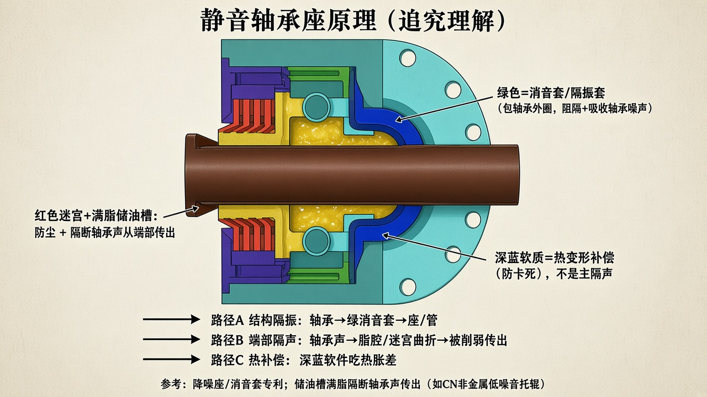

# 静音轴承座原理（按检索纠正）

> 此前把「红迷宫+脂」简单说成「完全不能隔音」，理解偏了。  
> 对照你的 CAD 颜色 + 公开专利表述，重新说明。  
> 只保留示意图与说明。  
> **红色密封改进：** [`RED_SEAL_IMPROVE.md`](./RED_SEAL_IMPROVE.md)



原 CAD：[`figures/ref-existing-damping-seat.jpg`](./figures/ref-existing-damping-seat.jpg)

---

## 你这套静音轴承座在干什么（三分法）

| 你图里的颜色 | 材质/形态 | 在原理里的角色 |
|--------------|-----------|----------------|
| **绿色** | 包在轴承外的消音/隔振套（或含轴承的隔振安装） | **结构隔振 + 吸声**：切断轴承外圈与硬座硬碰，阻隔、吸收轴承噪声 |
| **红色迷宫 + 齿间润滑脂** | 软质迷宫 + **储油槽满脂** | **防尘**；同时脂腔用来**隔断轴承转动声从端部传出**（行业专利原文即如此写） |
| **深蓝色** | **软材质** | **热变形补偿**：吃掉轴/座/轴承热胀差，防卡死、防过盈突变（你指出的用途，正确） |
| 青绿端座 / 管 | 承力壳体 | 承载；静音不靠它“硬抱”轴承外圈 |
| 实心轴 | 钢，固定 | 承力定位；本身不做阻尼 |

```text
路径A 结构：轴承振动 → 绿消音套/降噪座 → 削弱后再到端座/管
路径B 端部：轴承声 → 满脂储油槽 + 迷宫曲折 → 向外传出被削弱
路径C 热：  温升胀差 → 深蓝软件变形吸收 → 不卡、不额外挤响
```

这三条是**一套静音轴承座**，不是只靠其中一条。

---

## 网上资料怎么写的（据此纠正）

1. **降噪座 / 消音套**（对应你绿色这一路）  
   - 轴承与冲压座之间加非金属降噪座，外圈与座**不直接接触**，消除外圈—座摩擦尖叫。  
   - 消音套包住轴承，对轴承噪声做**阻隔、吸收**，并要防相对转动。  
   - 例：[复合式静音托辊（降噪座）](https://www.xjishu.com/zhuanli/34/201821146219.html)、[非金属低噪音托辊（消音套）](https://www.xjishu.com/zhuanli/34/202022644237.html)

2. **储油槽满脂**（对应你红色迷宫之间的脂）  
   - 迷宫与轴承之间留间隙形成储油槽，**加注润滑脂**后：既多一层密封，又写明可**「隔断轴承转动声音的传出」**达到降噪。  
   - 例：[非金属低噪音托辊](https://www.xjishu.com/zhuanli/34/202022644237.html)  
   - 迷宫曲折小室也有消耗声能的说法（同系静音托辊专利）。  

   → 所以：**红密封之间有脂，正是静音轴承座设计的一部分**；先前说成「有脂也不算隔音贡献」不准确。更精确的说法是：  
   **脂腔主要堵的是「从端部往外传」的声路**，不是把整辊变成隔音箱；也代替不了绿色消音套的结构隔振。

3. **软质热补偿**（对应你深蓝色）  
   - 复合材料托辊里常见弹性圈/皮碗：升温压缩、降温回弹，保持密封组件轴向关系，避免热胀卡死或散开。  
   - 例：[动态密封复合材料托辊](https://www.xjishu.com/zhuanli/34/202120731662.html)  
   - 你说明深蓝是软材、为消除热变形——与这类设计一致。

---

## 之前错在哪

| 旧说法 | 纠正后 |
|--------|--------|
| 红迷宫+脂「不能隔音」 | 专利明确写脂腔可**隔断轴承声从端部传出**；兼防尘。应承认这是静音路径之一 |
| 几乎只强调「外圈尼龙座→管体」 | 你的座是**多路径**：绿消音隔振 + 红脂腔隔声 + 深蓝热补偿 |
| 深蓝被当成次要弹性减振 | 主职是**热变形**，按你的定义 |

---

## 对着你 CAD 的认件（便于继续改）

- **绿**：轴承隔振/消音安装面——静音主结构件之一，可再强化（材料阻尼、防转、包覆完整性）。  
- **红+脂**：迷宫 + 满脂储油——密封 + **端部隔声**，脂要充满，间隙与级数影响声路和阻力。  
- **深蓝软件**：热补偿——保留软质与轴向吃胀量；不要改成硬件。  

若继续改进，应在**承认这三路径**的前提下各自加强，而不是用「迷宫不隔音」一笔抹掉红+脂。
