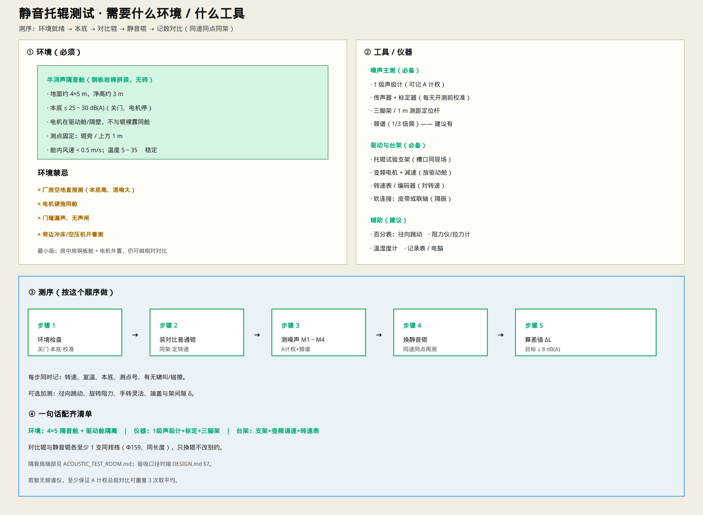

# 静音托辊测试 · 工具与环境

> 测序需要什么环境、什么仪器，按清单配齐即可。  
> 只保留示意图与说明。

---

## 一句话

**隔音舱 + 电机隔离 + 1 级声级计 + 定转速台架**；同速同点同架对比普通辊与静音辊。

---

## ① 环境（必须）

| 项 | 要求 |
|----|------|
| 试验舱 | 半消声拼装舱（钢板夹岩棉，无砖）；**省钱推荐内净 4.0×3.0×2.8 m**（见隔音房文档） |
| 本底 | 关门、电机停：**≤ 25～30 dB(A)** |
| 驱动 | 电机/减速在 **驱动舱或隔壁**，软连接传动 |
| 测点 | 辊旁/上方固定 **1 m** |
| 气候 | 舱内风速 &lt; 0.5 m/s；温度大致 **5～35℃** 且稳定 |

禁忌：厂房空地硬测、电机同舱裸拖、门缝漏声、旁边大噪声设备开着测。

舱体细部：[`ACOUSTIC_TEST_ROOM.md`](./ACOUSTIC_TEST_ROOM.md)

---

## ② 工具 / 仪器

### 噪声（必备）

| 工具 | 干什么 |
|------|--------|
| **1 级声级计** | 测 A 计权总级 |
| **传声器 + 声校准器** | 开测前标定 |
| **三脚架 / 1 m 定位杆** | 测点固定可重复 |
| 频谱（1/3 倍频） | 建议有：看轴承高频有无下降 |

### 驱动与台架（必备）

| 工具 | 干什么 |
|------|--------|
| 托辊试验工装 | 槽口与现场一致；设计见 [`IDLER_TEST_FIXTURE.md`](./IDLER_TEST_FIXTURE.md) |
| 变频电机 + 减速 | 调到目标转速（放驱动舱） |
| 转速表 / 编码器 | 对转速 |
| 皮带或软联轴 | 隔振，少传电机噪声 |

### 辅助（建议）

| 工具 | 干什么 |
|------|--------|
| 百分表 | 径向跳动 |
| 旋转阻力仪 / 拉力计 | 阻力对比 |
| 温湿度计 | 记录环境 |
| 记录表 / 电脑 | 存数、算 ΔL |

试样：同规格 **普通对比辊** + **静音辊** 各至少 1 支（Φ159、同长度）。

---

## ③ 测序

1. **环境检查**：关门 → 测本底 → 校准声级计  
2. **装普通对比辊** → 调到额定转速（Φ159 约 240～420 r/min，对应带速 2～3.5 m/s）  
3. **测噪声** M1～M4（A 计权；有频谱一并记）  
4. **只换静音辊**，同速同点同架再测  
5. **算差值** ΔL = L普通 − L静音；参考目标 **≥ 8 dB(A)**  

每步记：转速、室温、本底、测点、有无啸叫/碰擦。  
可选：跳动、旋转阻力、端盖与架间隙 δ。

验收口径：[`DESIGN.md`](./DESIGN.md) §7。

---

## ④ 最小配置（预算紧）

- 钢板房中房 + 电机外置  
- 1 级声级计 + 校准器 + 三脚架  
- 支架 + 变频调速 + 转速表  
- 先做 **相对对比**（绝对值误差大，差值仍有用）

指标限值表：[`TEST_METRICS.md`](./TEST_METRICS.md)
