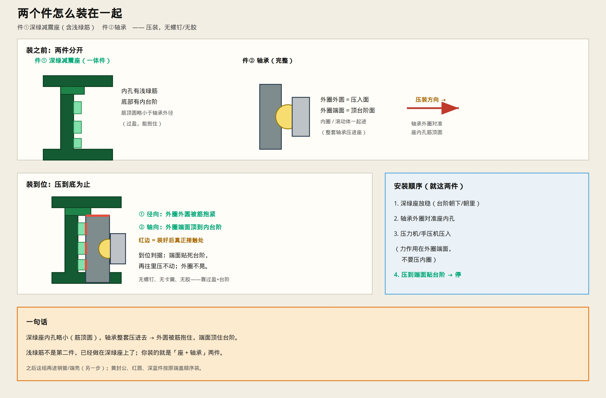

# 两个件怎么装在一起

> 件① = 深绿减震座（含浅绿减震筋，一体）  
> 件② = 轴承  
> 只讲这两件之间的装配。



---

## 先认清件数

- 浅绿筋 **不是** 单独一件，已经做在深绿座内孔上  
- 你要装的就是：**减震座 + 轴承**

---

## 怎么装

1. 深绿座放稳，内台阶朝下（或朝里）  
2. 轴承外圈对准座内孔（对准筋顶圆）  
3. 压力机压入——**力只压在外圈端面**，不要压内圈  
4. 压到外圈端面贴死内台阶 → 停  

**固定方式：过盈抱合 + 台阶挡死。无螺钉、无卡簧、无胶。**

```text
压入前：筋顶圆略小于轴承外径（过盈）
压到位：外圆被筋抱紧（径向）+ 端面顶台阶（轴向）
```

---

## 装好怎么验

- 外圈不晃、不转得相对座打滑啸叫  
- 再往里压不动（已贴台阶）  
- 外圈与深绿内壁光面之间仍有缝（正常）  

之后这组再进钢管/端壳；黄封公、红唇、深蓝件按端盖原顺序装。
